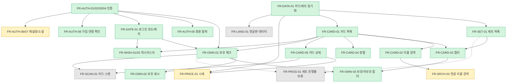

# 02. 기능 명세서 및 사용자 시나리오

관련 문서: [01 요구사항](01-requirements.md) · [05 API](05-api-spec.md) · [06 화면](06-screens-and-user-flow.md) · [10 추적표](10-traceability-review.md)

## 1. 우선순위와 구현 의존성

### 1.1 기능 의존성 그래프

### 1.2 구현 순서 요약
1. **데이터 기반**: FR-DATA-01/02 → FR-SET-01 → FR-CARD-01..05 (인증 없이 가능)
2. **계정**: FR-AUTH-01..05 (카드 조회와 병렬 진행 가능)
3. **보유 기능**: FR-OWN-01..03 (카드 목록 + 인증이 모두 끝나야 가능)
3-1. **위시리스트(P0)**: FR-GATE-01과 카드 목록 위에 구현. 보유 체크와 같은 패턴(멱등 PUT/DELETE + RLS)이라 PH-5에서 함께 만든다
4. **P1 확장**: 시세 → 한글 검색 (서로 독립, 순서는 제안). 세트 진행률은 보류
5. **P2**: 스캔, 한글판, 다국어, 웹

## 2. 기능별 상세 명세

각 기능은 *입력 / 처리 규칙 / 출력 / 예외 / 선행 조건* 순으로 기술한다. 상태 코드와 에러 코드는 [05 API](05-api-spec.md) 참고.

---

### 2.1 인증/계정 (FR-AUTH) — P0

> 인증 방식은 **DEC-04 미확정**. 아래는 후보 중 "이메일+비밀번호" 기준의 규칙이며, 방식이 바뀌면 FR-AUTH-01/02 상세만 수정한다. 나머지(세션, 탈퇴)는 공통.

#### FR-AUTH-01 회원가입
- 입력: 이메일, 비밀번호, (선택) 표시 이름
- 규칙
  - 이메일 형식 검증, 대소문자 구분 없이 유일(소문자 정규화 저장)
  - 비밀번호 최소 8자 **[제안]**, 이메일과 동일 금지, 흔한 비밀번호 차단은 P1
  - 약관·개인정보처리방침 동의 필수 (동의 일시 저장)
  - **연령 확인 (FR-AUTH-08, P0) [확정]**: 생년월일을 입력받아 만 14세 미만은 가입 불가, 게스트 열람 안내 (11 §4). 법정대리인 동의 체계를 만들지 않는 대신 가입을 막는 방식. 저장은 "만 14세 이상 확인 시각"만 하고 생년월일 원본은 저장하지 않는다. 서버 측 검증(우회 방지) 방식은 PH-0/PH-4에서 결정
  - 이메일 확인 메일을 사용 **[제안]**: Supabase 호스팅 프로젝트는 기본으로 이메일 확인이 켜져 있고 프로덕션 체크리스트도 권장한다. 이 경우 가입 직후가 아니라 **확인 링크를 누른 뒤** 로그인 상태가 된다 (앱의 딥링크 처리 필요)
- 예외: 중복 이메일, 형식 오류, 약관 미동의, 연령 미충족
- 메일 발송은 **커스텀 SMTP 구성** 필요 (기본 SMTP는 발송 제한이 있어 프로덕션 비권장, 11 §6)

#### FR-AUTH-02 로그인
- 입력: 이메일, 비밀번호
- 규칙: 실패 시 "이메일 또는 비밀번호가 올바르지 않습니다" 단일 메시지(계정 존재 여부 노출 금지). 연속 실패 시 일시 제한(레이트 리밋)
- 출력: access/refresh 토큰, 사용자 기본 정보

#### FR-AUTH-03 로그아웃
- 현재 기기 refresh 토큰 폐기, 앱 저장 토큰 삭제. 다른 기기 세션에는 영향 없음

#### FR-AUTH-04 세션 유지(토큰 갱신)
- access 토큰 만료 시 refresh 토큰으로 자동 갱신(사용자 비개입). refresh 만료/폐기 시 로그인 화면으로 이동
- 앱 재실행 시 저장된 refresh 토큰으로 자동 로그인

#### FR-AUTH-05 회원 탈퇴
- 입력: 비밀번호 재확인(또는 최근 로그인 확인)
- 규칙: 확인 화면에서 "보유 기록 등 모든 데이터가 삭제됨" 고지 → 계정, 보유 기록, 위시리스트, 세션 삭제. 즉시 삭제 **[제안]** (유예 기간 방식은 미채택)
- 스토어 정책상 앱 내 삭제 경로 + 웹 삭제 요청 링크 필요 (07 문서)

#### FR-AUTH-06 비밀번호 재설정 (P1, 출시 전 필수)
- 이메일로 재설정 링크/코드 발송 → 새 비밀번호 설정 → 기존 세션 모두 폐기
- 메일 발송 서비스 필요 (DEC-02/06과 함께 결정)

#### FR-AUTH-07 소셜 로그인 (P1, 조건부)
- Google 로그인. 기존 이메일 계정과의 연결 정책은 DEC-04 확정 시 정의

---

### 2.2 카드 데이터 동기화 (FR-DATA) — P0, 시스템 기능

#### FR-DATA-01 카드/세트 동기화
- 목적: Pokémon TCG API 데이터를 자체 DB에 반영 (03 문서 §3 결정에 근거)
- 동작
  1. **초기 전체 동기화**: 세트 전체 → 세트별 카드 전체 (페이지 크기 최대 250)
  2. **주기 동기화**: 세트 목록의 갱신 시각/신규 세트 확인 → 변경된 세트만 카드 재조회 **[제안: 일 1회]**
  3. upsert(없으면 추가, 있으면 갱신). 소스에서 사라진 카드는 삭제하지 않고 `is_active=false` 처리 (사용자 보유 기록 보존)
  4. 동기화 중 오류 시 부분 반영 허용하되 **기존 데이터는 삭제/오염하지 않음**. 재시도(백오프)
- 규칙
  - API 키는 서버 환경 변수로만 관리
  - 일일 호출 예산(20,000)의 일부만 사용하도록 요청 수 제한
  - 소스 응답을 내부 모델로 변환하는 **어댑터 계층** 사용 (소스 교체 대비, R-02)
- 출력: DB 갱신, 작업 이력(`sync_jobs`)

#### FR-DATA-02 동기화 상태 기록/알림
- 작업 시작/종료/처리 건수/오류를 기록. 실패 시 운영자 알림 **[제안: 로그 기반 알림 또는 이메일 — 도구 미정]**

---

### 2.3 세트 (FR-SET) — P0

#### FR-SET-01 세트 목록 조회
- 출력: 세트 id, 이름, 시리즈, 출시일, 카드 수, 로고/심볼 URL
- 기본 정렬: 출시일 최신순. 필터 화면의 세트 선택 목록에 사용
- 선행: FR-DATA-01

---

### 2.4 카드 조회 (FR-CARD) — P0

#### FR-CARD-01 카드 목록
- 입력: 페이지 커서, 페이지 크기(기본 30, 최대 100 **[제안]**)
- 규칙: 커서 기반 무한 스크롤. 기본 정렬 = 세트 출시일 내림차순 → 카드 번호 오름차순 **[제안]**
- 출력 항목(목록용 최소): id, 이름, 이미지(small), 세트 요약, 번호, 희귀도, 타입 목록, **owned**(로그인 시)
- 비로그인 열람: **허용 [확정, 2026-10-07]**. 검색·필터·정렬·상세까지 모두 게스트 가능, `owned` 필드는 게스트 응답에서 생략
- 비활성(`is_active=false`) 카드는 기본 목록에서 제외, 단 보유 기록이 있는 경우 "보유 카드만 보기"에서는 표시

#### FR-CARD-02 이름 검색
- 입력: 검색어 `q`
- 규칙: 대소문자 무시, 부분 일치(포함), 앞뒤 공백 제거, 최소 1자 **[제안]**, 입력 디바운스(앱 300ms **[제안]**)
- 다른 필터/정렬과 **AND 결합**
- 한글 입력 시: MVP에서는 결과 없음 안내 + "영문 카드명으로 검색해 보세요" 안내 문구. 한글 매핑은 FR-SRCH-02 (P1)

#### FR-CARD-03 필터
- 대상: 세트(`setIds`), 타입(`types`), 희귀도(`rarities`)
- 규칙
  - 같은 항목 내 다중 선택은 **OR** (예: Fire 또는 Water)
  - 서로 다른 항목 간은 **AND**
  - 필터 옵션 목록은 서버가 제공 (`/filters`, `/sets`)
  - 선택된 필터 개수를 UI에 표시, "전체 초기화" 제공
- 타입은 포켓몬/에너지 카드에만 존재. 트레이너 카드는 타입 필터 선택 시 제외됨 (정상 동작)

#### FR-CARD-04 정렬
- MVP 정렬 키 **[제안]**: 이름(A→Z/Z→A), 세트 출시일(최신/오래된), 카드 번호, HP(높은/낮은), 희귀도(DEC-11 매핑 필요)
- 모든 정렬은 동점 시 `id`로 안정 정렬 (커서 페이징 일관성)
- HP가 없는 카드(트레이너 등)는 HP 정렬 시 항상 맨 뒤

#### FR-CARD-05 카드 상세
- 출력: 큰 이미지, 이름, 슈퍼타입/서브타입, HP, 타입, 진화 정보, 특성/기술, 약점/저항/후퇴비용, 규칙 텍스트, 세트 정보, 번호, 일러스트레이터, 희귀도, 플레이버 텍스트, 도감번호, **보유 여부**
- 시세(FR-PRICE-01)는 P1에서 같은 화면에 섹션으로 추가
- 존재하지 않는 id → 404 화면

---

### 2.5 보유 관리 (FR-OWN) — P0

#### FR-OWN-01 보유 체크/해제
- 동작: 카드 목록 항목 또는 상세 화면의 토글로 보유/미보유 전환 (로그인 필요)
- 규칙
  - **멱등성**: 이미 보유인 카드를 다시 보유로 설정해도 성공 (PUT), 미보유 해제도 성공 (DELETE)
  - 앱은 **낙관적 업데이트** 후 서버 응답 실패 시 롤백 + 안내
  - 비로그인 상태에서 토글 시 로그인 유도 화면으로 이동 후 복귀
  - 존재하지 않는 카드 id → 404
- 향후 확장: 수량/상태/버전 컬럼 추가 (04 문서 §6)

#### FR-OWN-02 보유 표시
- 목록 항목: 체크 배지/아이콘, 미보유는 시각적으로 구분(예: 약간 흐리게 — UI 세부는 06 문서)
- 상세: 토글 버튼 + 상태 문구
- 서버는 목록/상세 응답에 `owned` 포함 (N+1 없이 JOIN/IN 조회)

#### FR-OWN-03 보유/미보유만 보기
- `owned=all|owned|unowned` (기본 all). 다른 필터/검색/정렬과 AND 결합
- 로그인 필수. 비로그인 시 UI에서 옵션 비활성 또는 로그인 유도

---

### 2.5.1 로그인 전용 기능 접근 제어 — FR-GATE-01 (P0) **[확정]**

- 로그인 전용 기능: 보유 체크/해제, 보유·미보유 보기, 위시리스트 추가/제거/조회
- 비로그인 사용자가 해당 기능의 버튼/탭/필터를 누르면 **로그인 화면으로 이동**한다 (사용자 확정).
- 로그인(또는 가입)에 성공하면 **원래 화면과 하려던 동작으로 복귀**해 이어서 수행한다 (예: 카드 상세에서 보유 체크 → 로그인 → 같은 카드 상세로 돌아와 보유 체크 적용).
- 로그인 화면에서 뒤로 가면 동작은 취소되고 원래 화면 유지.
- 서버/DB 측: 로그인 전용 데이터는 RLS로 본인만 접근 (07 §6). UI 차단만으로 접근 제어하지 않는다.
- **연령 정책 [확정]**: 회원가입 시 연령 확인으로 **만 14세 미만은 가입 불가·게스트 열람만** 허용한다 (FR-AUTH-08, 11 §4).

### 2.5.2 위시리스트 — FR-WISH-01/02 (P0) **[확정: 1차 출시 포함]**
- 사용자 결정(2026-10-07): "즐겨찾기"는 별도 기능이 아니라 **① 내가 가진 카드 체크(보유)와 ② 위시리스트** 두 기능이다.
- **FR-WISH-01 추가/제거**: 카드 목록 항목과 카드 상세에서 위시리스트 아이콘(♡/♥)으로 토글. 보유 체크(✓)와 **서로 다른 아이콘/위치**로 구분. 멱등(PUT/DELETE), 낙관적 업데이트·롤백은 보유와 동일. 게스트는 FR-GATE-01로 로그인 유도.
- **FR-WISH-02 조회**: 하단 탭 "위시리스트" 화면에서 내 위시 카드를 목록으로 표시(카드 목록과 같은 카드 컴포넌트·무한 스크롤·정렬은 담은 순서 최신순 **[제안]**). 비어 있으면 빈 상태 안내("마음에 드는 카드를 ♡로 담아보세요") + 카드 목록으로 이동 버튼.
- **보유와의 관계 [확정]**: 보유와 위시는 **독립 상태**이며 동시에 존재할 수 있다. 보유로 체크해도 위시리스트에서 **자동 제거하지 않는다.** 위시 목록에는 해당 카드의 `owned`를 표시한다. 서버도 이 규칙을 강제하지 않는다(두 테이블을 서로 건드리지 않음).
- 위시리스트 목록에서도 보유 여부(`owned`)를 표시한다 (같은 `list_cards` 계열 응답 형식 재사용).
- 규칙: 탈퇴 시 삭제, 존재하지 않는 카드 404, 위시리스트 최대 개수 제한은 두지 않음(과도한 사용은 레이트 리밋으로 방어).

### 2.6 P1/P2 기능 개요 (구현 시 상세화)

| ID | 개요 | 핵심 규칙(제안) | 선행 |
|----|------|------------------|------|
| FR-PROG-01 | **보류** (사용자 결정으로 제외, 요구가 생기면 검토). 세트별 `보유 수 / 세트 전체 카드 수` 진행률 | 분모 정책(`printed_total` vs `total`)은 착수 시 결정 | FR-OWN-01, FR-SET-01 |
| ~~FR-WISH-01/02~~ | **P0로 승격**되어 §2.5.2에 상세 기술 | | |
| FR-PRICE-01 | 상세에 TCGplayer(USD)/Cardmarket(EUR) 시세와 갱신일 표시 | 통화 환산 없이 원 통화 표기(P1 초기). 갱신일 명시, "참고용" 고지 | FR-CARD-05, FR-DATA-01 |
| FR-SRCH-02 | 한글로 포켓몬 이름 검색 → 도감번호로 매핑해 카드 검색 | PokéAPI 등의 한글명 데이터 사용 가능 여부와 라이선스 확인 필요(DEC-10) | FR-CARD-02 |
| FR-SCAN-01 | 카메라로 카드 인식해 카드 상세/보유 체크 연결 | PoC로 인식 방식(OCR vs 이미지 매칭) 비교 후 결정. 온디바이스/서버 미정 | FR-CARD-05, FR-OWN-01 |

## 3. 사용자 시나리오

### 시나리오 S-01: 신규 사용자 가입 후 첫 보유 체크 (핵심 흐름)
1. 사용자가 앱 설치 후 실행 → 스플래시 → **카드 목록(게스트 상태)**
2. 카드를 둘러보다가 보유 체크 아이콘을 누르면 로그인 화면으로 이동 → "회원가입" → 이메일/비밀번호/연령/약관 동의 → 확인 메일 링크 확인 → 로그인
3. 원래 보던 카드 화면으로 복귀해 보유 체크가 적용됨. 이후 스크롤하며 카드를 본다
4. 검색창에 `charizard` 입력 → 결과 표시
5. 결과 중 한 카드의 체크 아이콘 탭 → 즉시 "보유" 표시
6. 앱 종료 후 재실행 → 자동 로그인, 같은 카드가 "보유"로 표시됨

### 시나리오 S-02: 세트·희귀도로 좁혀 미보유 카드 찾기
1. 목록 화면에서 필터 버튼 → 세트 "Vivid Voltage" 선택, 희귀도 "Rare Holo VMAX" 선택 → 적용
2. 보기 옵션에서 "미보유만" 선택
3. 목록에 해당 조건의 미보유 카드만 표시. 카드 탭 → 상세 → 보유 체크 → 뒤로 가면 목록에서 해당 카드가 (미보유 필터이므로) 사라지거나 갱신됨

### 시나리오 S-03: 다른 기기에서 로그인해 동기화 확인
1. 새 기기에서 로그인 → 목록의 보유 표시가 기존 기기와 동일

### 시나리오 S-04: 네트워크 불안정 중 보유 체크
1. 지하철에서 카드 체크 → 즉시 반영 표시
2. 서버 요청 실패 → 토글이 원래 상태로 되돌아가고 "저장하지 못했어요. 다시 시도해 주세요" 안내 + 재시도 버튼

### 시나리오 S-05: 회원 탈퇴
1. 내 정보 → 계정 삭제 → 고지 문구 확인 → 비밀번호 입력 → 확인
2. 로그인 화면으로 이동. 같은 이메일로 재가입 시 이전 보유 기록은 없음

### 시나리오 S-06: 정렬/무한 스크롤 일관성
1. 정렬을 "HP 높은 순"으로 변경 → 맨 위로 스크롤 초기화
2. 계속 스크롤해도 중복/누락 카드 없이 이어서 로드

### 시나리오 S-07: 비정상 상황
- 토큰 만료 중 보유 체크 → 자동 갱신 후 요청 재시도(사용자 인지 없음)
- refresh도 만료 → 로그인 화면 이동, 로그인 후 원래 화면으로 복귀
- 카드 이미지 로드 실패 → 기본 플레이스홀더, 탭하면 재시도
- 서버 점검(503) → "잠시 후 다시 시도" 화면

### 시나리오 S-08 (P0): 위시리스트
1. 카드 상세에서 ♡를 눌러 위시리스트에 담기(게스트라면 로그인 후 복귀하여 담김)
2. 하단 "위시리스트" 탭에서 담은 카드 확인 → 카드를 구해서 ✓(보유) 체크 → 위시리스트에 그대로 남고 "보유함"으로 표시됨 **[확정]**
3. 다른 기기로 로그인해도 같은 위시리스트가 보임

### 시나리오 S-09 (P1): 시세
1. 카드 상세에서 시세 확인(갱신일 표시)

### 시나리오 S-10: 만 14세 미만 사용자
1. 가입 화면에서 연령 확인 → 만 14세 미만 → "만 14세 미만은 가입할 수 없어요. 카드 둘러보기는 계속 이용할 수 있어요." → 게스트로 목록·검색·상세 이용
2. 보유/위시 기능을 누르면 가입 불가 안내 (로그인 화면으로 보내지 않음) **[제안]**

## 4. 인수 기준(Acceptance Criteria) 요약 — P0

| 기능 | 인수 기준 |
|------|-----------|
| FR-AUTH-01 | 유효 입력이면 계정 생성 및 토큰 발급, 중복 이메일은 거부, 비밀번호 평문이 어디에도 저장/로그되지 않음 |
| FR-AUTH-05 | 탈퇴 후 해당 사용자의 모든 행이 삭제되고, 기존 토큰으로 API 호출 시 401 |
| FR-DATA-01 | 재실행해도 중복 데이터 없음(멱등), 실패 후 재실행 시 이어서 완료, 기존 데이터 유지 |
| FR-CARD-01 | 페이지를 끝까지 넘겨도 중복·누락 없음, 마지막 페이지에서 `hasNext=false` |
| FR-CARD-02/03/04 | 조건 조합 결과가 DB 직접 쿼리 결과와 일치, 결과 0건 시 빈 상태 안내 |
| FR-OWN-01 | 체크/해제가 서버에 저장되고 다른 기기에서도 동일, 반복 요청에도 오류 없음, 타 사용자 데이터에 영향 없음 |
| FR-OWN-03 | owned/unowned 필터가 다른 필터와 조합해도 정확 |

## 5. 확정 필요 항목 (이 문서 관련)
- DEC-07 게스트 열람 **[확정]**, DEC-08 오프라인 **[확정: 온라인 전용]**, DEC-10 한글 검색, DEC-11 희귀도 정렬 순서
- ~~위시리스트와 보유의 상호작용 정책~~ **확정**: 독립, 자동 제거 없음
- 세트 진행률 분모 정책 (P1 착수 전)
