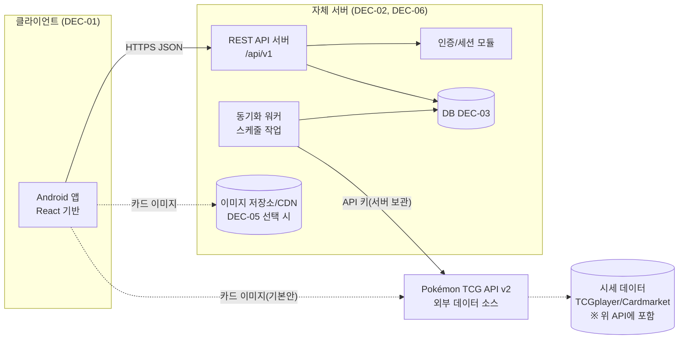
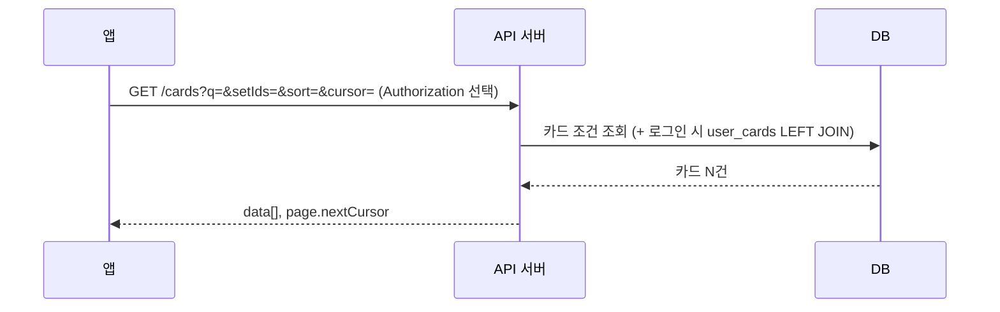
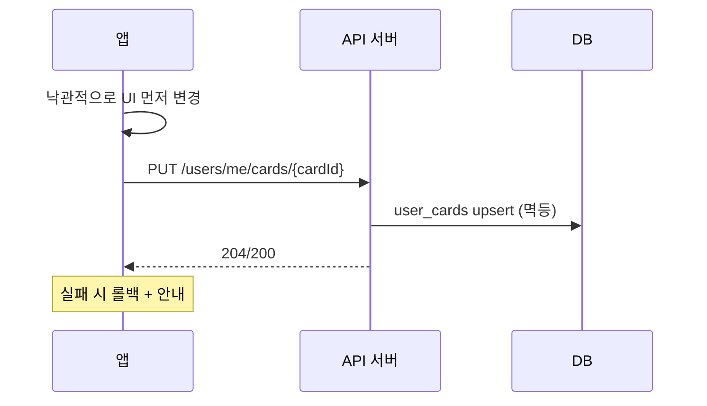
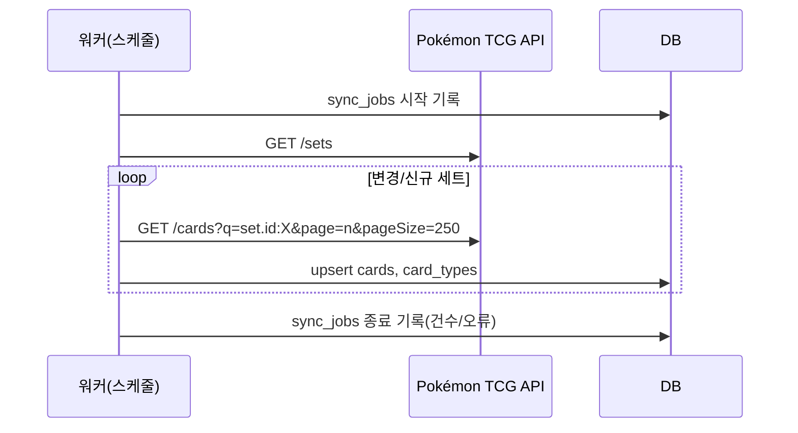
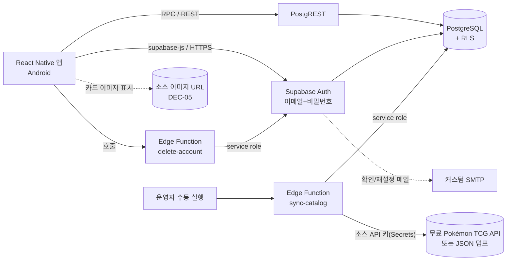

# 03. 시스템 아키텍처 및 기술 스택

관련 문서: [01 요구사항](01-requirements.md) · [04 DB](04-database-and-erd.md) · [05 API](05-api-spec.md)

> **원칙**: 사용자가 확정하지 않은 기술 결정은 확정하지 않는다. 이 문서는 (1) 확정/위임된 사항, (2) 후보 비교, (3) 잠정 후보 의견을 구분해 기술한다.

## 1. 아키텍처 개요

### 1.1 논리 구성도



핵심 포인트
- 앱은 **자체 API 서버하고만 통신**한다(카드 데이터 외부 API 직접 호출 없음).
- **동기화 워커**가 외부 API를 호출해 DB를 채운다. API 키는 서버에만 있다.
- 카드 이미지는 **소스 URL을 앱이 로드해 화면에 표시**(DEC-05 확정). 파일은 우리 저장소에 복사하지 않는다.

### 1.2 계층 구조 (서버)

```
[Controller/Route]  요청 검증, 인증 확인, 응답 포맷
[Service]           비즈니스 규칙 (필터 결합, 보유 판정, 탈퇴 등)
[Repository]        DB 접근 (쿼리 빌더/ORM은 DEC-02 이후)
[Integration]       외부 API 어댑터 (Pokémon TCG API → 내부 모델 변환)
[Batch]             동기화 스케줄러/작업
```

### 1.3 클라이언트 구조 (프레임워크 무관 원칙)
- 화면(UI) / 상태·데이터 훅 / API 클라이언트 / 공용 타입 분리
- API 응답 타입은 05 문서 스키마(OpenAPI)에서 생성해 공유 **[제안]**
- UI 문자열은 리소스 파일 분리(NFR-I18N-01)
- 웹 확장 대비: 비즈니스 로직과 API 클라이언트를 UI에서 분리해 재사용 가능하게 한다 (프레임워크 선택에 따라 재사용 범위 상이)

### 1.4 주요 데이터 흐름

**카드 목록 조회**


**보유 체크**


**동기화**


## 2. 외부 데이터 소스

> ⚠ **4차 갱신**: 개발·1차 출시 소스는 **무료 Pokémon TCG API v2 및/또는 JSON 덤프**로 확정(DEC-16). 유료 Scrydex는 쓰지 않는다. 이 API는 2027-03-01 종료 예정이므로 그 전에 후속 소스를 다시 정한다. 앱은 소스를 호출하지 않고 운영자가 적재한 DB만 조회한다. 어댑터 계층(ADR-03)은 소스 교체를 위해 유지한다.

| 항목 | 내용 (2026-10 문서 확인) |
|------|--------------------------|
| 소스 | [Pokémon TCG API v2](https://docs.pokemontcg.io/) |
| 제공 데이터 | 카드(이름, 타입, HP, 기술, 특성, 약점, 희귀도, 번호, 일러스트레이터, 이미지 URL, 도감번호 등), 세트, TCGplayer(USD)/Cardmarket(EUR) 시세 |
| 호출 한도 | API 키 있음: 20,000건/일 · 키 없음: 1,000건/일, 30건/분 |
| 언어 | 영문판 중심 (한글판 없음) |
| 리스크 | 커뮤니티 운영, 변경/중단 가능 (R-02), 약관/IP 확인 필요 (R-01) |
| 대응 | 어댑터 계층 + 자체 DB 보유 |

> 구현 착수 전(Phase 0)에 실제 API로 응답 샘플, 전체 카드 수, 응답 속도, 안정성을 **검증 작업**으로 확인한다 (09 문서 T-001).

## 3. [위임 결정] 카드 데이터 확보 방식 비교

사용자 요청: "외부 API 실시간 호출" vs "외부 API 데이터를 내 DB에 복사" 중 비교 후 결정.

### 3.1 방식 정의
- **방식 A. 실시간 호출**: 앱(또는 우리 서버)이 사용자 요청마다 외부 API를 호출
  - A-1: 앱이 외부 API 직접 호출
  - A-2: 우리 서버가 프록시로 호출(캐시 없음/약한 캐시)
- **방식 B. DB 복사(동기화)**: 서버가 주기적으로 외부 데이터를 자체 DB에 저장하고 앱은 자체 API만 사용

### 3.2 비교표

| 평가 항목 | A-1 앱 직접 호출 | A-2 서버 프록시 | B DB 복사 |
|-----------|------------------|-----------------|-----------|
| 호출 한도 (키 20,000/일) | 사용자 수에 비례해 폭증. 키를 앱에 넣으면 유출, 키 없으면 1,000/일 | 사용자 수에 비례. 캐시 없이는 한도 초과 쉬움 | 동기화 때만 사용(전체 수집이 수십~수백 건 수준 추정) |
| 보유 정보와 결합 (`owned` 필터/목록) | 불가능에 가깝다 (카드 DB가 우리 쪽에 없음) | 어렵다 (외부 API 결과와 `user_cards` 결합을 앱/서버 메모리에서 처리) | **쉬움** (SQL JOIN) |
| 보유/미보유 필터 + 정렬 + 페이징 | 불가 | 외부 API 쿼리 문법 제약, 사실상 불가 | **가능** |
| 검색/필터 자유도 | 외부 API 제공 범위 | 동일 | DB 인덱스로 자유롭게 (한글명 매핑, 희귀도 순서 등 확장 가능) |
| 응답 속도/안정성 | 외부 API 속도·장애에 직접 영향 | 동일 | 자체 DB 속도, 외부 장애와 무관 (NFR-AVAIL-01) |
| 데이터 최신성 | 항상 최신 | 최신 | 동기화 주기만큼 지연 (일 1회 등) — 카드 데이터는 변동 적어 영향 작음 |
| 한글판 등 다른 소스 병합 | 불가 | 어려움 | **쉬움** (자체 스키마에 병합) |
| 소스 장애/중단 리스크 | 서비스 전체 중단 | 서비스 전체 중단 | 데이터 보존, 소스 교체 가능 |
| 구현 복잡도 | 낮음 (그러나 요구기능 충족 불가) | 중 | 중~높음 (동기화 배치 + DB 설계) |
| 운영 비용 | 서버 비용 없음, 그러나 기능 불가 | 서버 필요 | 서버 + DB 필요 (이미 계정 기능 때문에 필요) |

### 3.3 결정 근거 및 결론 **[위임 결정]**
1. 요구사항 **FR-OWN-03(보유/미보유 필터)** 과 **FR-CARD-03/04(필터/정렬)** 는 보유 데이터(우리 DB)와 카드 데이터를 결합해야 한다. 이는 방식 B에서만 단순하고 정확하게 구현된다.
2. 서버/DB는 계정 기능 때문에 어차피 필요하므로 B의 추가 인프라 비용이 작다.
3. 여러 사용자가 같은 키를 공유하는 구조에서 A는 한도(20,000/일)를 사용자 수에 비례해 소모한다.
4. 한글판(P2) 병합과 한글명 검색(P1) 등 향후 기능은 자체 DB가 있어야 가능하다.

**결론: 방식 B(자체 DB 동기화)를 채택한다.** 단, "실시간 호출"은 다음 보조 용도로만 한정한다.
- 동기화 워커가 외부 API를 호출하는 것 자체 (배치성 호출)
- (선택, 제안) DB에 없는 카드 id 조회 시 서버가 외부에서 1건 가져오는 폴백 — MVP에는 포함하지 않음

> 이 결정은 사용자 승인 시 최종 확정된다.

**4차 확정 (사용자)**: 방식 B를 최종 채택한다. 사용자는 외부 카드 API를 호출하지 않고 **Supabase DB만** 조회한다. 운영자가 카드 전체 목록을 **한 번(필요 시 재실행)** 가져와 DB에 저장한다. 1차 출시에서는 **매일 자동 동기화를 필수로 두지 않는다**(무료·단순성). 신규 세트가 나오면 같은 적재 작업을 운영자가 다시 실행한다.

## 4. 기술 스택 후보 비교

> **2차 갱신 결과**: DEC-01 = **React Native 확정**, DEC-03 = **Supabase PostgreSQL 확정**, DEC-04 = **이메일+비밀번호 확정**, DEC-02 = **Supabase 중심 서버리스 [위임 결정]**. 아래 비교표는 선택 근거 기록으로 남기며, 확정 스택의 상세는 **§8**을 본다.

### 4.1 DEC-01 클라이언트 (React 계열, Android 우선 + 웹 확장 예정)

| 평가 항목 | A. React Native (Expo 등) | B. React(웹) + Capacitor | C. PWA + TWA |
|-----------|---------------------------|---------------------------|---------------|
| React 선호 충족 | 예 (React 문법/훅) | 예 (React 웹 그대로) | 예 |
| Android 앱 품질 | 네이티브 UI 컴포넌트, 긴 이미지 목록에서 유리 | WebView 기반, 대량 이미지 목록 성능 주의 | WebView(브라우저) 기반, 앱 느낌 제한 |
| 카메라/스캔(P2) | 카메라/ML 라이브러리 생태계 양호 | 플러그인 가능, 성능은 상대적 열세 | 제약 큼 |
| 웹 확장(P2) | 웹은 별도 React 앱 또는 React Native Web, 로직 재사용 | **한 코드베이스로 웹+Android** | 웹이 곧 앱 |
| 스토어 출시 | 일반적 | 일반적 | TWA 요건 충족 시 가능, 포트폴리오 인상 약함 |
| 학습/구성 복잡도 | 중 (네이티브 빌드 환경 필요) | 낮음~중 | 낮음 |
| iOS 확장(DEC-12) | 쉬움 | 쉬움 | 제한적 |

잠정 의견(미확정): Android 우선, 대량 이미지 목록, 향후 카메라 스캔을 고려하면 **A가 유력**. 웹 코드 공유를 최우선하면 B를 검토. 결정은 사용자 선호와 PoC(목록 스크롤 성능) 결과로 한다.

### 4.2 DEC-02 백엔드

| 평가 항목 | Node.js + TypeScript | Spring Boot (Java/Kotlin) | BaaS (Supabase/Firebase 등) |
|-----------|----------------------|----------------------------|------------------------------|
| 클라이언트와 타입 공유 | 쉬움 (TS 통일) | OpenAPI 생성으로 가능 | SDK 제공 |
| 동기화 배치 구현 | 쉬움 | 쉬움 (스케줄러 성숙) | 별도 함수/크론 구성 필요, 제약 확인 필요 |
| 복잡한 필터/정렬/JOIN 쿼리 | 가능 | 가능 | 제품별 쿼리 제약 확인 필요 |
| 인증 직접 구현 부담 | 있음(라이브러리 사용) | 있음 | **내장** |
| 포트폴리오 가치 | 서버 설계 역량 시연 | 서버 설계 역량 시연 | 서버 구현 역량 시연은 적음 |
| 운영/비용 | 소규모 저비용 | 메모리 요구 다소 큼 | 무료 티어 가능, 락인 |

### 4.3 DEC-03 DB 엔진

| 후보 | 장점 | 단점/고려 |
|------|------|-----------|
| PostgreSQL | 관계형 + JSON 컬럼 + 배열 + 부분 문자열 검색 인덱스 지원, 확장성 | 관리형 서비스 선택 필요 |
| MySQL/MariaDB | 널리 쓰임, 호스팅 흔함 | JSON/검색 기능이 상대적으로 단순 |
| 문서형(MongoDB 등) | 카드 JSON 저장 용이 | 보유 JOIN/필터 결합과 트랜잭션 설계가 불리 |

잠정 의견(미확정): 데이터가 관계형(사용자-카드-세트)이므로 관계형 DB가 적합. 04 문서의 논리 모델은 엔진 독립으로 작성했다.

### 4.4 DEC-04 인증 방식

| 후보 | 장점 | 단점/고려 |
|------|------|-----------|
| 이메일 + 비밀번호(자체) | 외부 의존 적음, 이해 쉬움 | 비밀번호 재설정/메일 발송/보안 직접 부담 |
| Google 로그인 | 가입 간편, 비밀번호 보관 불필요 | Google 의존, 계정 없는 사용자 제외 |
| BaaS 인증 | 구현 부담 최소 | 벤더 락인 (DEC-02와 결합 결정) |

잠정 의견(미확정): MVP는 이메일+비밀번호, P1에 Google 추가를 검토. 다만 메일 인프라 부담 때문에 Google 로그인 우선도 현실적 대안이다.

### 4.5 DEC-05 카드 이미지 **[확정]**

**화면에 카드 그림이 나온다.** "소스 URL만 표시"는 이미지를 빼겠다는 뜻이 아니다.

| 무엇을 하는가 | 무엇을 하지 않는가 |
|----------------|-------------------|
| 목록·상세·확대에 실제 카드 이미지를 보여 준다 (small / large) | 2만 장 이미지 파일을 우리 Supabase Storage에 복사해 두지 않는다 |
| DB에는 `image_small_url`, `image_large_url` 문자열만 저장 | 이미지 바이너리를 DB에 넣지 않는다 |
| 앱이 그 URL에서 이미지를 받아 그리고, **디스크/메모리 캐시**로 스크롤을 빠르게 한다 | 오프라인 전용 도감은 만들지 않음 (DEC-08) |

이유: 자체 미러링은 저장·전송 비용, 소스 약관(재배포 금지 가능), 저작권 부담이 커진다. URL 표시 + 앱 캐시는 그림이 잘 보이면서도 그 부담을 피한다. 소스 CDN이 느리거나 막히면 플레이스홀더·재시도. 신고 시 원격 플래그로 이미지 표시만 끌 수 있다.

자체 Storage 복제는 출시 후 품질 문제가 확인되면 재검토한다.

### 4.6 기타 미확정
| ID | 항목 | 비고 |
|----|------|------|
| DEC-06 | 호스팅 | 매니지드 PaaS / VM / 서버리스. 비용(NFR-COST-01)과 스케줄 작업 지원 여부로 비교 |
| DEC-15 | 크래시/분석 | Firebase Crashlytics 등. 개인정보 처리방침 영향 고려 |
| - | 형상관리/CI | Git + CI(GitHub Actions 등) **[제안]**, 도구는 Phase 1에서 확정 |
| - | API 문서 | OpenAPI(Swagger) **[제안]** |

## 5. 환경 구성 **[제안]**

| 환경 | 용도 |
|------|------|
| local | 개발자 PC, 로컬 DB |
| staging | 통합 테스트, 스토어 내부 테스트 트랙 연결 |
| production | 실서비스 |

- 환경별 설정/비밀 값은 환경 변수/시크릿 관리 (저장소에 커밋 금지)
- DB 스키마는 마이그레이션으로 버전 관리

## 6. Android 빌드 관련 메모
- Android 프로젝트(Gradle 포함)가 생성되면, 사용자 규칙에 따라 Android Studio Gradle 자동 리로드 설정(`.idea/workspace.xml`의 `AutoImportSettings.autoReloadType = ALL`)을 유지하고, Gradle/`local.properties` 변경 후 수동 Sync가 필요 없도록 구성한다. (개발 단계에서 적용, 현재는 코드 없음)

## 7. 기술 의사결정 상태 요약 (2차 갱신)

| DEC | 항목 | 상태 |
|-----|------|------|
| DEC-01 | 클라이언트 | React Native **확정** |
| DEC-02 | 백엔드 | Supabase 중심 서버리스 **위임 결정** (§8) |
| DEC-03 | DB | Supabase PostgreSQL **확정** |
| DEC-04 | 인증 | 이메일+비밀번호 **확정** (Supabase Auth) |
| DEC-05 | 이미지 | **확정: 소스 URL을 앱이 로드해 그림을 보여 줌** + 앱 캐시. Storage 복제 없음 |
| DEC-06 | 호스팅 | Supabase (정적 문서 호스팅만 미정) |
| DEC-16 | 데이터 소스 | **개발·1차: 무료 Pokémon TCG API/덤프.** 앱은 DB만 조회. 유료 소스 미사용. 2027-03-01 전 재결정 |

## 8. 확정 스택 상세 (Supabase 기반) — 2차 갱신

### 8.1 스택 요약

| 계층 | 선택 | 상태 |
|------|------|------|
| 클라이언트 | React Native (Android 전용 빌드). Expo 사용 여부는 PH-1에서 결정 | **[확정]** |
| 인증 | Supabase Auth — 이메일+비밀번호 (비밀번호 해시, 세션/refresh 토큰, 재설정 메일 내장) | **[확정]** |
| DB | Supabase PostgreSQL (**프로젝트 `card-dex`**, id `xtgozzmwvapuqendqqdf`, 리전 **ap-northeast-2** 서울, ACTIVE). 구 `pokemon-tcg-dex`는 삭제 방침 | **[확정]** |
| 읽기/조회 API | PostgREST(자동 REST) + **Postgres 함수(RPC)** — 카드 목록/상세/필터 | **[위임 결정]** |
| 사용자 데이터 접근 제어 | **RLS(행 수준 보안)** 정책 | **[위임 결정]** |
| 서버 측 로직 | **Edge Functions(TypeScript/Deno)** — 카드 동기화, 계정 삭제 | **[위임 결정]** |
| 스케줄 | 1차는 **운영자 수동 적재**(Edge Function 또는 스크립트). `pg_cron` 일일 호출은 P1 선택 | **[확정: 1차 수동]** |
| 메일 | 커스텀 SMTP(SendGrid/AWS SES 등 — 서비스 미정) | **[미확정]** 출시 전 필수 |
| 별도 백엔드 서버 | 없음 (필요 시 후속 도입) | **[위임 결정]** |

### 8.2 구성도



앱은 `SRC`에 연결하지 않는다. 1차에서 `pg_cron` 주기 호출은 두지 않는다.

### 8.3 추천 근거 (백엔드: Supabase 중심 서버리스)

| 기준 | 판단 |
|------|------|
| 사용자 선호 반영 | 이미 Supabase를 DB로 쓰기로 하고 MCP까지 연결됨 → 별도 서버를 추가하면 운영 대상이 2배 |
| 직접 구현 부담 | 인증(해시, 세션 회전, 재설정 메일, 속도 제한), 사용자 데이터 보호(RLS)가 **내장** → 05/07 문서에서 우려했던 "인증 직접 구현 부담"과 "메일 인프라"가 SMTP 연결 수준으로 축소 |
| 요구 기능 적합성 | 복잡한 필터/정렬/보유 결합은 **SQL 함수 한 개**로 구현 가능(키셋 페이징 포함). 동기화는 세트 단위로 쪼갠 Edge Function으로 처리 가능 |
| 위치/지연 | 리전이 **서울(ap-northeast-2)** 이라 한국 출시에 유리 |
| 비용 | 개발 중 무료, 출시 시 유료 플랜(무료는 7일 저활동 시 정지). 별도 서버 비용 없음 |
| 포트폴리오 가치 | SQL 설계, RLS, Edge Function, 스케줄링 설계 역량을 보여줄 수 있음 (단, "서버 프레임워크 구현"은 보여주지 못함) |
| 단점 | Supabase 종속(벤더 락인), Edge Function 실행 한도, 비즈니스 로직이 SQL/RLS에 분산 |

### 8.4 대안과 전환 조건
- **별도 Node.js/TypeScript 서버(NestJS 등)** 를 추가해야 하는 신호: 시세 갱신·스캔 연동 등으로 Edge Function의 **CPU 2초/요청, 벽시계 150초(무료)/400초(유료)** 한도에 자주 걸림, 복잡한 도메인 로직 증가, 광고 서버 검증 등 서버 코드가 많아짐.
- 전환 비용을 낮추는 설계 규칙: (1) 소스 어댑터와 변환 로직을 **순수 TypeScript 모듈**로 분리(Edge Function과 Node 양쪽에서 재사용), (2) 앱은 **API 계층(서비스 모듈)** 만 통해 Supabase를 호출, (3) 마이그레이션은 SQL 파일로 관리.

### 8.5 책임 분담 (논리 API → Supabase 구현, 상세는 05 문서 §0)

| 기능 | 구현 방식 |
|------|-----------|
| 가입/로그인/로그아웃/세션 갱신/비밀번호 재설정 | Supabase Auth (`supabase-js`) |
| 카드 목록(검색·필터·정렬·키셋 페이징·`owned` 결합) | Postgres 함수 `list_cards(...)` (RPC), 게스트는 anon 권한으로 호출 가능, 로그인 시 `auth.uid()`로 보유 결합 |
| 카드 상세 | Postgres 함수 `get_card(id)` 또는 뷰 |
| 세트 목록/필터 옵션 | 공개 읽기 테이블/함수 `list_sets`, `get_filters` |
| 보유 체크/해제 | `user_cards` 테이블 insert(upsert)/delete — RLS: `user_id = auth.uid()` |
| 계정 삭제 | Edge Function `delete-account` (service role로 `auth.users` 삭제 → FK CASCADE) |
| 카드 동기화 | Edge Function `sync-catalog` (세트 단위 분할). **1차는 운영자 수동 전체 적재**, 재실행으로 신규 세트 반영. `pg_cron`은 P1 |
| 가입 연령 확인 서버 검증 | **[미확정]** 클라이언트 검증만으론 우회 가능 → Auth Hook 또는 가입 Edge Function 경유 여부 PH-0에서 결정 |

### 8.6 키·비밀 관리
- 앱에 포함 가능: Supabase **publishable(anon) 키** (RLS가 보호). 반드시 모든 테이블 RLS를 켠 상태에서만 허용.
- 앱에 절대 포함 금지: **service role 키**, 데이터 소스 API 키, SMTP 자격 증명 → Edge Function Secrets / Vault.
- 광고 SDK 키는 광고 정책(DEC-14/17) 확정 후.

### 8.7 프로젝트 상태 (4차)
- **사용 프로젝트**: `card-dex` (`xtgozzmwvapuqendqqdf`), 리전 `ap-northeast-2`, 조직 `rveunqenhzsicpcpicrn`(free), 생성 비용 $0, 상태 ACTIVE. URL: `https://xtgozzmwvapuqendqqdf.supabase.co`
- 기존 `pokemon-tcg-dex`(`qehoxvcwzkagyvybhpki`, INACTIVE): **삭제하기로 확정**. MCP에 프로젝트 삭제 도구가 없어 **대시보드에서 삭제**해야 한다. [Deleting Your Project](https://supabase.com/docs/guides/platform/delete-project) — 삭제는 되돌릴 수 없다.
- **스키마 마이그레이션은 설계 승인 전까지 실행하지 않음.**

## 9. 아키텍처 결정 기록(ADR) 요약

| ID | 결정 | 상태 |
|----|------|------|
| ADR-01 | 카드 데이터는 서버 DB에 적재하고 앱은 DB만 조회(방식 B). 1차는 운영자 수동 전체 적재 | **[확정]** |
| ADR-02 | 앱은 자체 API만 호출, 외부 API 키는 서버 전용 | **[제안]** (NFR-SEC-02) |
| ADR-03 | 외부 소스 접근은 어댑터 계층으로 격리 | **[제안]** |
| ADR-04 | REST + JSON, `/api/v1` 버전 prefix, 커서 기반 페이징 | **[제안]** |
| ADR-05 | 보유 기록은 `user_cards` 단일 테이블, 행 존재 = 보유 (확장 컬럼 추가 가능) | **[제안]** |
| ADR-06 | 카드/세트에 `language` 컬럼을 두어 한글판 확장 대비 | **[제안]** |
| ADR-07 | 소스에서 사라진 카드는 비활성 처리(삭제 금지) | **[제안]** |
| ADR-08 | 서버는 Supabase 중심 서버리스(PostgREST+RPC, RLS, Edge Functions). 별도 서버는 필요 시 도입 | **[위임 결정]** (8.3) |
| ADR-09 | 모든 테이블 RLS 활성화, 카드 데이터는 공개 읽기·쓰기 금지(service role만), 사용자 데이터는 본인만 | **[제안]** |
| ADR-10 | 소스 어댑터/변환 로직은 순수 TypeScript 모듈로 분리 (Edge Function·Node 양쪽 재사용) | **[제안]** |
| ADR-11 | 카드 이미지는 Storage/DB에 복제하지 않고 소스 URL을 앱이 표시한다. 앱 디스크 캐시로 성능을 확보한다 | **[확정]** (DEC-05) |
