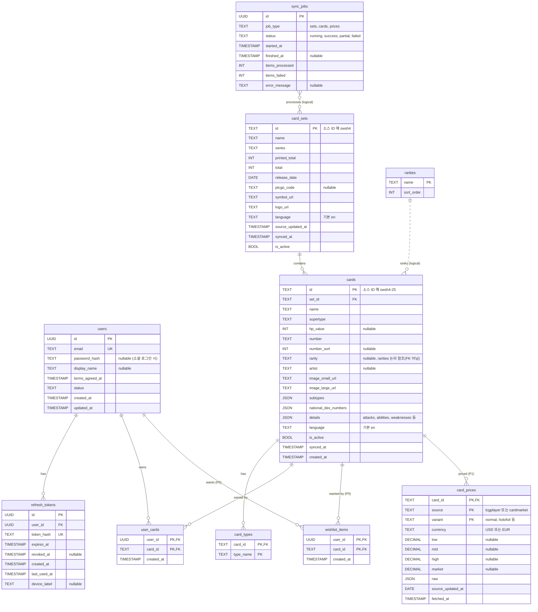

# 04. 데이터베이스 설계 및 ERD

관련 문서: [03 아키텍처](03-architecture-and-tech-stack.md) · [05 API](05-api-spec.md) · [10 추적표](10-traceability-review.md)

> **DB 엔진은 DEC-03 미확정**이다. 이 문서는 *논리 모델*이며 데이터 타입은 엔진 독립적으로 표기한다.
> (UUID, TEXT, INT, BOOL, TIMESTAMP, DATE, JSON, DECIMAL). 엔진 결정 후 물리 스키마(DDL)로 변환한다.

> **2차 갱신 (DB = Supabase PostgreSQL 확정)**: 이 문서의 `users`, `refresh_tokens` 테이블은 **Supabase Auth가 관리하는 `auth.users`로 대체**되고, 앱 전용 정보는 `public.profiles`에 둔다. 구현 매핑, RLS 정책, RPC 함수 목록은 **§9**를 본다. `password_resets` 테이블은 필요 없다(Auth가 처리).

## 1. 설계 원칙
1. **카드 데이터(읽기 위주)** 와 **사용자 데이터(쓰기 발생)** 를 분리한다.
2. 필터/정렬/검색에 쓰는 필드는 **컬럼으로 정규화**, 화면 표시용 가변 구조(기술, 특성 등)는 **JSON 컬럼**으로 보관한다.
3. 소스 ID(`cards.id`, `card_sets.id`)를 PK로 사용해 동기화 upsert를 단순화한다.
4. 카드는 삭제하지 않고 `is_active`로 비활성화한다 (사용자 보유 기록 보존, ADR-07).
5. 한글판/다국어 대비로 `language` 컬럼을 둔다 (ADR-06). MVP는 `'en'` 고정.
6. 보유 정보는 `user_cards`의 **행 존재 = 보유** 로 표현하고, 수량/상태 등은 컬럼 추가로 확장한다 (ADR-05).
7. 사용자 삭제 시 사용자 소유 데이터는 **CASCADE 삭제** 한다.

## 2. ERD



> `rarities`와 `cards.rarity`의 관계: 소스에는 정해진 희귀도 목록이 없어 새 희귀도 문자열이 나타날 수 있다. 외래키를 강제하면 동기화가 실패하므로 **구현 시 FK 강제 대신 조회 시 LEFT JOIN** 으로 정렬 순서를 가져오고, 매핑이 없으면 맨 뒤로 정렬한다 (DEC-11, 아래 §4 참고).

## 3. 테이블 정의

### 3.1 `users` (P0)
| 컬럼 | 타입 | 제약 | 설명 |
|------|------|------|------|
| id | UUID | PK | 사용자 식별자 (순차 ID 노출 방지) |
| email | TEXT | UNIQUE, NOT NULL | 소문자 정규화 후 저장 |
| password_hash | TEXT | NULL 허용 | 단방향 해시(알고리즘은 07 문서). 소셜 전용 계정은 NULL |
| display_name | TEXT | NULL 허용 | |
| terms_agreed_at | TIMESTAMP | NOT NULL | 약관 동의 시각 |
| status | TEXT | NOT NULL, 기본 'active' | 향후 정지 등 확장 |
| created_at / updated_at | TIMESTAMP | NOT NULL | |

- 탈퇴 시 행 자체를 삭제(하드 삭제) **[제안]**. 감사 로그가 필요하면 익명화된 로그만 별도 보관

### 3.2 `refresh_tokens` (P0, 세션 방식 DEC-04에 따라 변경 가능)
| 컬럼 | 타입 | 제약 | 설명 |
|------|------|------|------|
| id | UUID | PK | |
| user_id | UUID | FK → users(id) ON DELETE CASCADE | |
| token_hash | TEXT | UNIQUE | 토큰 원문은 저장하지 않고 해시만 저장 |
| expires_at | TIMESTAMP | NOT NULL | |
| revoked_at | TIMESTAMP | NULL 허용 | 로그아웃/회전 시 설정 |
| created_at, last_used_at | TIMESTAMP | | |
| device_label | TEXT | NULL | 기기 구분(선택) |

- BaaS 인증을 쓰면 이 테이블은 제거될 수 있다.

### 3.3 `card_sets` (P0)
| 컬럼 | 타입 | 설명 |
|------|------|------|
| id | TEXT PK | 소스 세트 ID (예: `swsh4`). 한글판 추가 시 ID 체계는 DEC-09에서 정의 |
| name, series | TEXT | |
| printed_total | INT | 카드에 인쇄된 총 장수 |
| total | INT | 시크릿 레어 등 포함 총 장수 |
| release_date | DATE | 출시일 (정렬/기본 순서) |
| ptcgo_code | TEXT NULL | |
| symbol_url, logo_url | TEXT | |
| language | TEXT | 기본 'en' |
| source_updated_at | TIMESTAMP | 소스의 갱신 시각 (증분 동기화 판단) |
| synced_at | TIMESTAMP | 마지막 동기화 시각 |
| is_active | BOOL | |

### 3.4 `cards` (P0)
| 컬럼 | 타입 | 용도 | 설명 |
|------|------|------|------|
| id | TEXT PK | 식별 | 소스 카드 ID (예: `swsh4-25`) |
| set_id | TEXT FK → card_sets | 필터/조인 | |
| name | TEXT NOT NULL | 검색/정렬 | 영문 카드명 |
| supertype | TEXT | 표시/필터(P1) | Pokémon / Trainer / Energy |
| hp_value | INT NULL | 정렬 | 소스의 문자열 `hp`를 숫자로 변환. 변환 불가 시 NULL |
| number | TEXT | 표시 | 카드 번호 원문 (예: `25`, `TG01`) |
| number_sort | INT NULL | 정렬 | 번호의 숫자 부분 (정렬용) |
| rarity | TEXT NULL | 필터/정렬 | 소스 희귀도 문자열 |
| artist | TEXT NULL | 표시 | |
| image_small_url / image_large_url | TEXT | 표시 | 외부 URL (DEC-05) |
| subtypes | JSON | 표시 | 배열 |
| national_dex_numbers | JSON | 한글명 매핑(P1) | 정수 배열 |
| details | JSON | 상세 화면 | `hp`, `level`, `evolvesFrom`, `evolvesTo`, `abilities`, `attacks`, `weaknesses`, `resistances`, `retreatCost`, `convertedRetreatCost`, `rules`, `flavorText`, `regulationMark`, `legalities`, `ancientTrait` |
| language | TEXT | 확장 | 기본 'en' |
| is_active | BOOL | 노출 제어 | |
| synced_at, created_at | TIMESTAMP | | |

- 필터/정렬에 쓰지 않는 값은 `details` JSON에 두어 소스 스키마가 바뀌어도 마이그레이션을 줄인다.
- 시세는 **별도 테이블**(`card_prices`)로 분리한다. 갱신 주기가 카드 정보와 다르고 변경이 잦기 때문이다.
- 성능 최적화(구현 시 측정 후 결정): 세트 출시일 정렬이 느리면 `cards.set_release_date` 비정규화 컬럼 추가를 검토한다.

### 3.5 `card_types` (P0)
| 컬럼 | 타입 | 제약 |
|------|------|------|
| card_id | TEXT | PK(복합), FK → cards(id) |
| type_name | TEXT | PK(복합) — Fire, Water 등 |

- 카드 1장이 여러 타입을 가질 수 있어 다대다 보조 테이블로 정규화한다 (타입 필터를 인덱스로 처리).

### 3.6 `rarities` (P0, DEC-11)
| 컬럼 | 타입 | 설명 |
|------|------|------|
| name | TEXT PK | 소스 희귀도 문자열 |
| sort_order | INT | 희귀도 정렬 순서 (낮을수록 흔함) |

- 초기 값은 동기화 후 실제 희귀도 목록을 수집해 **사용자와 함께 순서를 정의**한다 (미정의 값은 맨 뒤).

### 3.7 `user_cards` (P0) — 보유 기록
| 컬럼 | 타입 | 제약 |
|------|------|------|
| user_id | UUID | PK(복합), FK → users ON DELETE CASCADE |
| card_id | TEXT | PK(복합), FK → cards(id) (ON DELETE RESTRICT) |
| created_at | TIMESTAMP | 체크한 시각 |

- 복합 PK가 중복 방지 + 멱등 upsert를 보장한다.
- 확장 예시(P2, 컬럼 추가): `quantity INT DEFAULT 1`, `condition TEXT`, `variant TEXT`, `note TEXT`, `updated_at`. 변형(variant)별로 구분이 필요해지면 PK에 `variant`를 포함하도록 마이그레이션한다 (현재 가정 A-03).

### 3.8 `sync_jobs` (P0)
| 컬럼 | 타입 | 설명 |
|------|------|------|
| id | UUID PK | |
| job_type | TEXT | `sets`, `cards`, `prices` |
| status | TEXT | `running`, `success`, `partial`, `failed` |
| started_at / finished_at | TIMESTAMP | |
| items_processed / items_failed | INT | |
| error_message | TEXT NULL | 요약 오류 (민감정보 제외) |

### 3.9 `wishlist_items` (**P0**, 사용자 확정)
`user_cards`와 동일 구조 (`user_id`, `card_id`, `created_at`; PK `(user_id, card_id)`). 보유와 위시는 **독립 상태**이며 동시에 존재할 수 있다 **[확정]**. 보유 체크가 `wishlist_items` 행을 삭제하지 않는다. 위시리스트 조회는 `created_at DESC`로 정렬하므로 `(user_id, created_at DESC)` 인덱스를 둔다. 사용자 삭제 시 CASCADE.

### 3.10 `card_prices` (P1)
| 컬럼 | 설명 |
|------|------|
| (card_id, source, variant) | 복합 PK. source: `tcgplayer`/`cardmarket`. variant: `normal`, `holofoil`, `reverseHolofoil`, `1stEditionHolofoil`, `1stEditionNormal` (cardmarket은 `default`) |
| currency | tcgplayer=USD, cardmarket=EUR |
| low, mid, high, market | 공통 필드. cardmarket 필드 매핑(예: market←trendPrice) 규칙은 P1 상세 설계에서 정의 |
| raw | 소스 원본 가격 JSON (avg1/avg7/avg30 등) |
| source_updated_at / fetched_at | 소스 갱신일 / 우리 수집 시각 |

- 가격 이력(그래프)은 P2 후보: `card_price_history` 별도 테이블.

### 3.11 `pokemon_names` (P1, DEC-10)
| 컬럼 | 설명 |
|------|------|
| national_dex_number | INT, PK(복합) |
| language | TEXT, PK(복합) (`ko`, `en`) |
| name | TEXT |

- `cards.national_dex_numbers`와 매핑해 한글 이름 검색(FR-SRCH-02) 지원. 데이터 출처/라이선스 확인 후 확정.

## 4. 인덱스 설계 (제안, 구현 시 쿼리 계획으로 검증)

| 테이블 | 인덱스 | 목적 |
|--------|--------|------|
| cards | (is_active, set_id, number_sort, id) | 세트별/번호 정렬 |
| cards | (name 소문자/정렬규칙 적용) + 부분 일치 검색 지원 인덱스 (엔진별: trigram/FULLTEXT 등) | FR-CARD-02. 부분 일치(`%q%`)는 일반 B-tree로 불가 → 엔진에 맞는 방식 필요 |
| cards | (rarity) | 희귀도 필터 |
| cards | (hp_value, id) | HP 정렬 |
| card_types | (type_name, card_id) | 타입 필터 (PK는 card_id 우선이므로 역방향 인덱스 필요) |
| card_sets | (release_date DESC) | 세트 목록/정렬 |
| user_cards | PK (user_id, card_id) | 사용자 보유 조회, 목록 JOIN |
| user_cards | (card_id) | 필요 시 (통계/삭제 확인) |
| refresh_tokens | (user_id), UNIQUE(token_hash), (expires_at) | 갱신/정리 |
| sync_jobs | (job_type, started_at DESC) | 이력 조회 |

## 5. 핵심 쿼리 패턴 (논리)

**카드 목록 (필터 + 정렬 + 보유 결합)**
```
SELECT c.*, s.name, (uc.card_id IS NOT NULL) AS owned
FROM cards c
JOIN card_sets s ON s.id = c.set_id
LEFT JOIN user_cards uc ON uc.card_id = c.id AND uc.user_id = :me     -- 로그인 시에만
WHERE c.is_active = true
  AND (:q IS NULL OR c.name 부분일치 :q)
  AND (:setIds 비어있음 OR c.set_id IN :setIds)
  AND (:rarities 비어있음 OR c.rarity IN :rarities)
  AND (:types 비어있음 OR EXISTS (SELECT 1 FROM card_types t WHERE t.card_id = c.id AND t.type_name IN :types))
  AND (:owned = 'all' OR (:owned = 'owned' AND uc.card_id IS NOT NULL) OR (:owned = 'unowned' AND uc.card_id IS NULL))
ORDER BY <정렬키>, c.id
키셋 페이징: WHERE (<정렬키>, c.id) > (:lastKey, :lastId)
LIMIT :limit + 1
```
- "보유 카드만 보기" 시 비활성 카드를 포함할지는 02 문서 규칙(보유한 비활성 카드는 표시)에 따라 조건 분기.

**보유 설정/해제**
```
INSERT INTO user_cards(user_id, card_id) VALUES (:me, :cardId) ON CONFLICT DO NOTHING   -- 멱등
DELETE FROM user_cards WHERE user_id = :me AND card_id = :cardId                         -- 멱등
```

## 6. 확장 시나리오와 스키마 영향

| 확장 | 변경 사항 | 영향도 |
|------|-----------|--------|
| 보유 수량/상태/메모 | `user_cards` 컬럼 추가 | 낮음 |
| 같은 카드의 버전(홀로/리버스) 구분 | `user_cards` PK에 `variant` 추가 (마이그레이션) | 중 |
| 한글판 | `cards`/`card_sets`의 `language='ko'` 행 추가. 카드 ID 체계, 영문/한글 카드 연결(동일 카드의 다른 언어판 매핑 테이블 `card_equivalents`) 필요 가능 | 중 (DEC-09) |
| 다국어 UI | DB 영향 없음(클라이언트 리소스). 카드 텍스트 다국어는 위 한글판 확장과 연동 | 낮음 |
| 시세 | `card_prices` 추가 + 동기화 작업 추가 | 낮음 |
| 소셜 로그인 | `auth_identities(user_id, provider, provider_user_id)` 추가 | 낮음 |
| 가격 이력 | `card_price_history` 추가 | 낮음 |

## 7. 데이터 수명주기
| 데이터 | 보존 정책 (제안) |
|--------|------------------|
| 사용자/보유 | 탈퇴 시 즉시 삭제 |
| refresh 토큰 | 만료/폐기 후 일정 기간(예: 30일) 지난 행 정리 배치 |
| sync_jobs | 90일 보관 후 삭제 |
| 카드/세트 | 삭제하지 않음 (비활성화) |
| 백업 | DB 일일 백업, 복구 테스트 1회 이상 (호스팅 환경 결정 후 구체화) |

## 8. 마이그레이션 원칙
- 스키마 변경은 **버전 관리되는 마이그레이션 파일**로만 수행(수동 변경 금지)
- 되돌릴 수 있는 변경을 기본으로 하고, 파괴적 변경은 2단계(추가→전환→삭제)로 진행

## 9. Supabase 구현 매핑 (2차 갱신) **[위임 결정/제안]**

> 아래는 설계이며 **아직 어떤 SQL도 실행하지 않았다.** 프로젝트가 INACTIVE 상태이고, 마이그레이션은 사용자 승인 후 PH-1에서 적용한다.

### 9.1 논리 모델 → Supabase 대응

| 논리 테이블 | Supabase 구현 | 변경 사항 |
|-------------|---------------|-----------|
| `users` | `auth.users`(Auth 관리) + `public.profiles` | 비밀번호 해시/이메일/세션은 Auth가 관리. 앱 정보만 `profiles` |
| `refresh_tokens` | (Auth 내부) | **테이블 제거** — 이슈 #13 해소 |
| `card_sets`, `cards`, `card_types`, `rarities` | `public` 스키마 테이블 | JSON → `jsonb`, 배열은 `jsonb`/`text[]` |
| `user_cards` | `public.user_cards` | `user_id uuid references auth.users(id) on delete cascade` |
| `sync_jobs` | `public.sync_jobs` | 클라이언트 접근 불가 |
| `wishlist_items` (**P0**) | `public.wishlist_items`, `user_id uuid references auth.users(id) on delete cascade` | |
| `card_prices`, `pokemon_names` (P1) | 동일 | |
| 즐겨찾기 | **별도 기능 없음** (보유 `user_cards` + 위시 `wishlist_items`로 대체, 사용자 확정) | |

### 9.2 `public.profiles` **[제안]**

| 컬럼 | 타입 | 설명 |
|------|------|------|
| id | uuid PK, FK → auth.users(id) ON DELETE CASCADE | |
| display_name | text null | |
| terms_agreed_at | timestamptz | 약관 동의 시각 |
| terms_version | text null | 동의한 약관 버전 (10 문서 이슈 #11 해소안) |
| age_verified_at | timestamptz null | **만 14세 이상 확인 시각만** 저장하고 생년월일 원본은 저장하지 않는다(개인정보 최소화, DEC-17 확정 시) |
| created_at | timestamptz | |

- 프로필 행 생성은 가입 시 트리거 또는 앱에서 처리 (PH-4에서 결정)

### 9.3 RLS 정책 (모든 테이블 RLS 활성화 — Supabase 프로덕션 체크리스트 필수 항목)

| 테이블 | anon(게스트) | authenticated(로그인) | service role(서버) |
|--------|--------------|------------------------|---------------------|
| card_sets, cards, card_types, rarities | SELECT 허용 | SELECT 허용 | 전체 (RLS 우회) |
| user_cards | **접근 불가** | SELECT/INSERT/DELETE: `user_id = auth.uid()` 만 | 전체 |
| wishlist_items (**P0**) | 접근 불가 | SELECT/INSERT/DELETE: `user_id = auth.uid()` 만 | 전체 |
| profiles | 접근 불가 | SELECT/UPDATE: `id = auth.uid()` | 전체 |
| sync_jobs | 접근 불가 | 접근 불가 | 전체 |
| card_prices (P1) | SELECT 허용 | SELECT 허용 | 전체 |

- 카드 테이블에 INSERT/UPDATE/DELETE 정책을 **만들지 않는다**(= 클라이언트 쓰기 불가, 동기화는 service role).
- 정책에서 `auth.uid()`는 `(select auth.uid())` 형태로 감싸 성능 이슈를 피한다 (Supabase 성능 권고).
- `get_advisors`(보안/성능 권고 도구)로 RLS 누락·인덱스 누락을 PH-1/PH-3/PH-9에서 점검한다.

### 9.4 RPC(Postgres 함수) 목록 **[제안]**

| 함수 | 용도 | 호출 가능 | 비고 |
|------|------|-----------|------|
| `list_cards(q, set_ids, types, rarities, owned, sort, ord, lim, cursor)` | FR-CARD-01~04, FR-OWN-02/03 | anon, authenticated | `owned`가 all이 아니면 `auth.uid()` 필요, 게스트가 `owned`/`unowned` 요청 시 오류. `lim` 상한 100 강제. 정렬 컬럼은 **허용 목록 CASE**로만 처리(문자열 연결 금지). `security invoker` |
| `get_card(card_id)` | FR-CARD-05 | anon, authenticated | 상세 + `owned` |
| `list_sets()` | FR-SET-01 | anon, authenticated | |
| `get_filters()` | FR-CARD-03 | anon, authenticated | 희귀도는 `rarities.sort_order` 순 |
| `set_owned(card_id, owned boolean)` (선택) | FR-OWN-01 | authenticated | 테이블 직접 upsert/delete도 가능. 하나로 통일 PH-5에서 결정 |
| `list_wishlist(lim, cursor)` | FR-WISH-02 | authenticated | `wishlist_items`와 `cards` 조인, `created_at DESC` 키셋 페이징, `owned` 포함. `list_cards`와 응답 형식 통일 |
| `set_wished(card_id, wished boolean)` (선택) | FR-WISH-01 | authenticated | 테이블 직접 upsert/delete로 대체 가능 (보유와 같은 방식으로 통일) |

### 9.5 인덱스/확장
- 부분 일치 검색: `pg_trgm` 확장 + `lower(name)` GIN 인덱스 **[제안]** — 확장 활성 여부는 구현 시 `list_extensions`로 확인
- 키셋 페이징용 복합 인덱스는 §4 설계 참고, 구현 시 `EXPLAIN`으로 검증
- `pg_cron`, `pg_net` 확장: 동기화 스케줄용 (활성화 필요, 구현 시)

### 9.6 마이그레이션 운영
- 마이그레이션 SQL은 저장소에 파일로 보관하고, Supabase CLI 또는 MCP `apply_migration`으로 적용 (적용은 **승인 후**)
- DDL은 `apply_migration`, 데이터 조회는 `execute_sql`을 구분 사용
- 개발용 분기(브랜치)는 유료 플랜 기능이므로 비용 확인 후 사용 (`get_cost`/`confirm_cost` 절차 준수)
- `generate_typescript_types`로 앱/Edge Function 공용 타입 생성 → 계약 테스트 입력으로 사용
