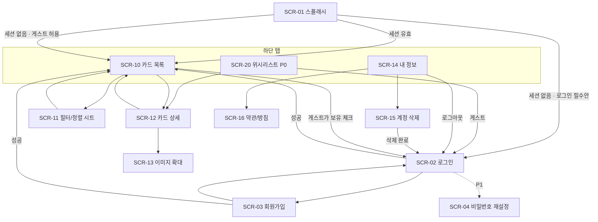
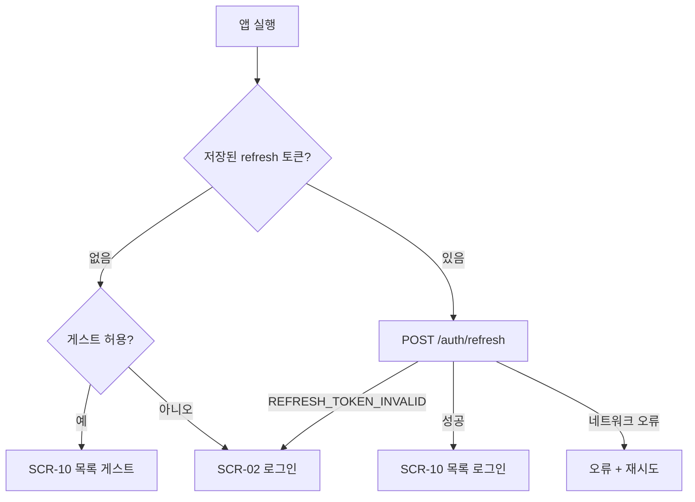
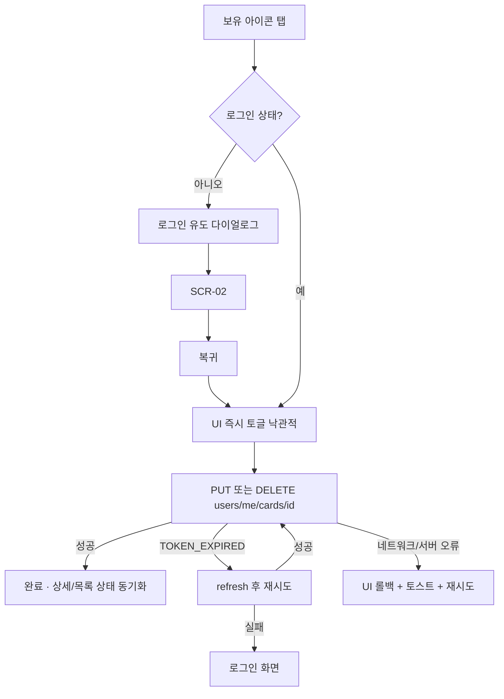
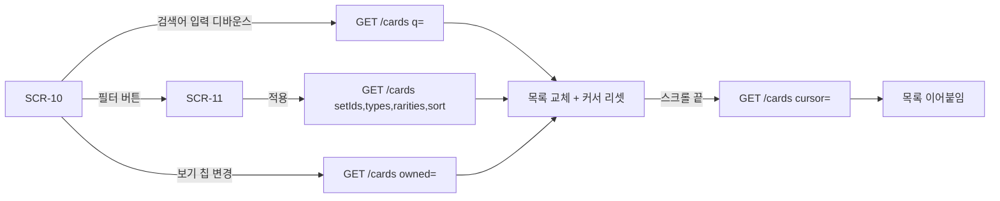
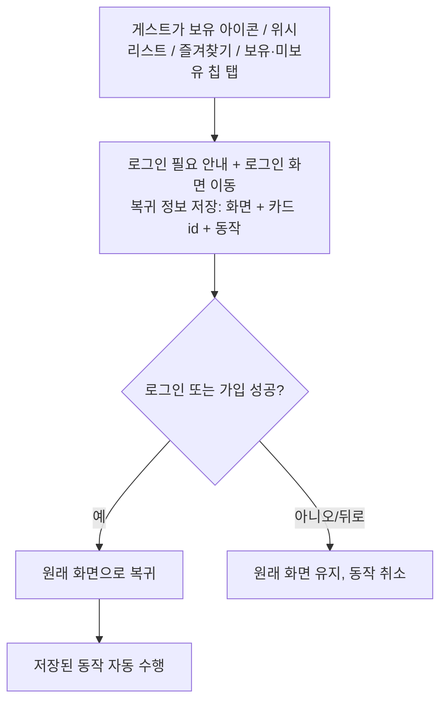

# 06. 화면 구성 및 사용자 흐름

관련 문서: [02 기능](02-functional-spec-and-scenarios.md) · [05 API](05-api-spec.md) · [10 추적표](10-traceability-review.md)

> 시각 디자인(색상, 폰트, 아이콘)은 이 문서의 범위가 아니다. 여기서는 **화면 구성, 상태, 이동, 데이터 연결**을 정의한다.
> UI 문구는 **한국어**, 리소스 파일로 분리한다 (NFR-I18N-01).
> **2차 갱신**: 게스트 열람은 **허용으로 확정**(DEC-07)되었다. 로그인 전용 기능(보유 체크, 위시리스트 — "즐겨찾기"는 이 두 기능을 뜻하며 별도 ★ 없음, 사용자 확정)을 비로그인 상태에서 누르면 **로그인 화면으로 이동하고, 로그인 후 원래 화면·동작으로 복귀**한다(FR-GATE-01). §6의 "로그인 필수" 열은 폐기된 대안으로 기록만 남긴다.

## 1. 화면 목록

| ID | 화면 | 우선순위 | 주요 기능 ID | 호출 API |
|----|------|----------|--------------|----------|
| SCR-01 | 스플래시/세션 확인 | P0 | FR-AUTH-04 | POST /auth/refresh, GET /users/me |
| SCR-02 | 로그인 | P0 | FR-AUTH-02 | POST /auth/login |
| SCR-03 | 회원가입 | P0 | FR-AUTH-01 | POST /auth/signup |
| SCR-04 | 비밀번호 재설정 | P1 | FR-AUTH-06 | POST /auth/password-reset/* |
| SCR-10 | 카드 목록 (홈) | P0 | FR-CARD-01~04, FR-OWN-01~03, FR-WISH-01 | GET /cards, PUT/DELETE /users/me/cards/{id}, PUT/DELETE /users/me/wishlist/{id} |
| SCR-11 | 필터/정렬 시트 | P0 | FR-CARD-03/04, FR-OWN-03, FR-SET-01 | GET /filters, GET /sets |
| SCR-12 | 카드 상세 | P0 | FR-CARD-05, FR-OWN-01/02, FR-WISH-01 | GET /cards/{id}, PUT/DELETE /users/me/cards/{id}, PUT/DELETE /users/me/wishlist/{id} |
| SCR-13 | 이미지 확대 뷰 | P0 (경량) | FR-CARD-05 | (상세 응답의 large 이미지) |
| SCR-14 | 내 정보/설정 | P0 | FR-AUTH-03/05 | GET /users/me, POST /auth/logout |
| SCR-15 | 계정 삭제 확인 | P0 | FR-AUTH-05 | POST /users/me/deletion |
| SCR-16 | 약관/개인정보처리방침 | P0 | 스토어 정책 | (웹 문서 링크) |
| SCR-20 | 위시리스트 | **P0** | FR-WISH-01/02 | GET /users/me/wishlist, DELETE /users/me/wishlist/{id} |
| SCR-21 | 세트 진행률 | **보류** (사용자 결정) | FR-PROG-01 | (보류) |
| SCR-30 | 카드 스캔 | P2 | FR-SCAN-01 | (조사 후 정의) |

## 2. 내비게이션 구조



- **하단 탭**: MVP는 `카드` / `위시리스트` / `내 정보` 3개. 게스트가 `위시리스트` 탭을 누르면 탭 전환 대신 로그인 유도(FR-GATE-01). 진행률(보류) 등은 추후 탭/화면 추가. 탭 구조는 기능 추가에 대비해 확장 가능하게 구성.

## 3. 화면별 상세

### SCR-01 스플래시/세션 확인
- 목적: 저장된 refresh 토큰이 있으면 갱신 시도 → 성공 시 홈, 실패 시 게스트/로그인 분기
- 상태: 로딩 / 네트워크 오류(재시도 버튼; 단, 카드 열람 가능하면 게스트로 진입 허용 여부는 DEC-07)
- 목표 표시 시간: 2초 이내 (NFR-PERF-02)

### SCR-02 로그인
```
[ 로고/앱 이름 ]
이메일        [__________]
비밀번호      [__________] (보기 토글)
[        로그인        ]
회원가입 | 비밀번호를 잊으셨나요?(P1)
둘러보기(게스트)  ← DEC-07 허용 시
```
- 검증: 이메일 형식/빈 값 → 필드 아래 인라인 오류
- 서버 오류 매핑: `INVALID_CREDENTIALS` → "이메일 또는 비밀번호가 올바르지 않습니다", `RATE_LIMITED` → "잠시 후 다시 시도해 주세요"
- 로그인 성공 시: 로그인 유도로 진입했다면 **원래 화면으로 복귀**, 아니면 홈

### SCR-03 회원가입
- 필드: 이메일, 비밀번호, 비밀번호 확인, 표시 이름(선택), **연령 확인(만 14세 이상 여부/생년월일 — 정답을 유도하지 않는 중립 방식)**, 약관·개인정보 동의 체크(필수, SCR-16 링크)
- 만 14세 미만으로 확인되면 가입 불가 안내("만 14세 미만은 가입할 수 없어요. 카드 둘러보기는 계속 이용할 수 있어요") + "카드 둘러보기"(게스트)로 이동 **[확정: 14세 미만 게스트 전용]**. 입력한 생년월일은 저장하지 않으며, 같은 기기에서 값만 바꿔 재시도하는 것을 막을지(쿨다운)는 PH-4 설계 시 결정
- 비밀번호 규칙 안내 표시. `EMAIL_ALREADY_EXISTS` → 이메일 필드 오류
- 가입 완료 후 "확인 메일을 보냈어요" 안내 화면(메일 재전송 버튼, 60초 간격 제한 안내). 메일 링크는 앱 딥링크로 열려 로그인 완료

### SCR-10 카드 목록 (홈)
```
┌────────────────────────────┐
│ [ 🔍 카드 이름 검색        ] │  ← FR-CARD-02
│ [필터 (2)] [정렬: 최신순 ▾]  │  ← SCR-11 진입, 선택 개수 배지
│ 보기: (전체|보유|미보유)      │  ← FR-OWN-03 (칩/세그먼트)
├────────────────────────────┤
│ ┌────┐ ┌────┐ ┌────┐       │
│ │카드│ │카드│ │카드│       │  3열 그리드 (또는 2열/리스트 전환 P1)
│ │ ✓ ♥│ │   ♡│ │ ✓  │       │  ✓ = 보유, ♥/♡ = 위시리스트 (각각 탭하여 토글)
│ └────┘ └────┘ └────┘       │
│ ...무한 스크롤...            │
└────────────────────────────┘
[ 카드 ]  [ 위시리스트 ]  [ 내 정보 ]
```
- 항목 표시: 카드 이미지(small), 이름, 세트/번호(간략), 보유 표시. 미보유는 이미지를 약간 흐리게 표시하는 방식을 **제안** (디자인 단계에서 확정)
- 항목 탭 → SCR-12. 보유 아이콘·위시 아이콘 탭 → 각각 토글(낙관적 업데이트, 실패 시 롤백). 두 아이콘은 모양·위치·색을 달리하고 터치 영역을 충분히 확보해 오터치를 막는다(3열 그리드에서 항목이 작으므로 디자인 단계 확인 필요)
- 상태
  | 상태 | 표시 |
  |------|------|
  | 최초 로딩 | 스켈레톤 그리드 |
  | 추가 로딩 | 하단 로딩 인디케이터 |
  | 결과 없음 | 빈 상태: "조건에 맞는 카드가 없어요" + 필터 초기화 버튼 (한글 검색 시 영문 검색 안내) |
  | 오류 | "불러오지 못했어요" + 다시 시도 |
  | 목록 끝 | 로딩 중단 (선택: "모두 불러왔어요") |
- 게스트가 "보유/미보유" 보기 칩을 탭하면 로그인 유도 다이얼로그를 띄운다 (API가 게스트의 `owned` 필터를 401로 거부하므로 UI에서 사전 차단, 10 문서 이슈 #2)
- 조건(검색어/필터/정렬/보기) 변경 시 목록 맨 위로 초기화 + 커서 리셋
- 검색어 입력 디바운스 300ms (제안)
- 게스트가 보유 아이콘 탭 → 로그인 유도 다이얼로그 → SCR-02 → 복귀 후 해당 동작 이어서 수행

### SCR-11 필터/정렬 시트 (바텀 시트)
```
정렬   (○ 최신 세트순 ○ 이름 A→Z ○ 카드 번호 ○ HP 높은순 ○ 희귀도순)
세트   [검색 가능한 세트 목록, 다중 선택]   ← GET /sets
타입   [Fire][Water][Grass]... 칩 다중 선택   ← GET /filters
희귀도 [Common][Uncommon]... 칩 다중 선택      ← GET /filters
[ 초기화 ]            [ 적용하기 ]
```
- 적용 버튼을 누를 때만 목록 갱신 **[제안]** (선택 중 매번 API 호출 방지)
- 버튼에 결과 건수("N개 카드 보기")는 MVP에서 표시하지 않는다. 사전 건수 조회가 필요해 `includeTotal` 호출 비용이 들기 때문이며, 필요하면 P1에서 추가 (10 문서 이슈 #3)
- "보유/미보유 보기"는 목록 상단 칩과 동일 상태를 공유 (시트에 중복 노출 시 동기화)
- 세트 목록은 시리즈별 그룹 + 검색 입력 제공 (세트 수가 많음)

### SCR-12 카드 상세
```
┌────────────────────────────┐
│ ← 뒤로                      │
│      [ 카드 큰 이미지 ]      │  탭 → SCR-13 확대
│ 이름 / 슈퍼타입 · 서브타입    │
│ [ ✓ 보유함 ]  ← 토글 버튼    │  FR-OWN-01
│ HP / 타입 / 희귀도           │
│ 특성 · 기술 · 약점/저항/후퇴  │
│ 세트 정보 · 번호 · 일러스트    │
│ 플레이버 텍스트              │
│ [ ♡ 위시리스트 ] ← 토글 버튼  │  FR-WISH-01
│ (P1) 시세 섹션               │
└────────────────────────────┘
```
- 보유·위시 토글 결과는 SCR-10 / SCR-20 목록의 같은 카드에도 반영(공유 캐시/상태 갱신)
- `NOT_FOUND` → "카드를 찾을 수 없어요" 화면 + 뒤로 가기

### SCR-13 이미지 확대
- 핀치 줌/더블탭, 닫기. 이미지 로드 실패 시 플레이스홀더 + 재시도

### SCR-20 위시리스트 (P0)
- 카드 목록(SCR-10)과 같은 카드 컴포넌트를 재사용: 이미지, 이름, 세트/번호, 보유 표시(✓), 위시 아이콘(♥, 탭하면 제거)
- 정렬: 담은 순서 최신순(고정, 제안). 검색/필터는 MVP 제외(제안)
- 상태: 로딩(스켈레톤) / 빈 상태("아직 담은 카드가 없어요" + "카드 둘러보기") / 오류(다시 시도) / 목록 끝
- 위시 제거는 즉시 목록에서 사라지게 하되 "실행 취소" 스낵바 3초 제공(제안, 오터치 대비)
- 게스트: 탭을 누르면 로그인 유도 → 로그인 후 이 탭으로 복귀 (FR-GATE-01)
- 만 14세 미만 게스트가 로그인 유도를 받았을 때의 경로는 SCR-03 연령 안내 참조

### SCR-14 내 정보/설정
- 표시: 이메일/이름, (P1: 수집 현황 요약)
- 메뉴: 로그아웃, 계정 삭제, 약관/개인정보처리방침, 오픈소스 라이선스·비공식 앱 고지(R-01), 앱 버전
- 게스트: 로그인/회원가입 버튼만 표시

### SCR-15 계정 삭제 확인
- 고지: "계정과 보유 기록이 영구 삭제되며 복구할 수 없습니다" → 비밀번호 입력 → [삭제] (위험 색상, 2단계 확인)
- 성공 시 로컬 토큰/캐시 삭제 후 SCR-02

### SCR-16 약관/개인정보처리방침
- 외부 웹 문서를 앱 내 웹뷰 또는 브라우저로 연결 (문서 호스팅 위치는 DEC-06과 함께)

## 4. 핵심 사용자 흐름

### 4.1 앱 시작 및 세션


### 4.2 보유 체크 흐름


### 4.3 검색·필터·정렬 흐름


### 4.4 계정 삭제 흐름
SCR-14 → SCR-15 → 비밀번호 확인 → `POST /users/me/deletion` → 성공: 로컬 데이터 삭제 → SCR-02 / 실패(`INVALID_CREDENTIALS`): 오류 표시

### 4.5 로그인 전용 기능 접근 흐름 (FR-GATE-01, 확정)

- 가입 경로는 이메일 확인 메일 때문에 앱을 벗어났다가 딥링크로 돌아오므로, **복귀 정보는 앱 재시작에도 보존**(로컬 저장)한다.

## 5. 상태 관리 및 데이터 연결 원칙 (클라이언트)

| 항목 | 원칙 |
|------|------|
| 서버 상태 | 카드 목록/상세/필터 옵션은 서버 상태로 취급(캐시, 재검증). 필터 옵션과 세트 목록은 오래 캐시 |
| 보유 상태 | 보유 토글 시 목록 캐시와 상세 캐시 **양쪽을 함께 갱신** (같은 카드 id 기준) |
| 조건 상태 | 검색어/필터/정렬/보기는 한 객체로 관리, 변경 시 목록 쿼리 키 변경 → 커서 리셋 |
| 세션 | 토큰은 OS 보안 저장소(Android Keystore 기반)에 저장 (07 문서) |
| 오프라인 | **온라인 전용 [확정, DEC-08]**: 네트워크 없으면 안내. 캐시에 남은 이미지가 잠깐 보일 수는 있으나 오프라인 탐색은 지원하지 않음 |
| 이미지 | 소스 URL 로드 + 디스크/메모리 캐시, 지연 로딩, 로드 실패 플레이스홀더 **[확정, DEC-05]** |

## 6. 게스트 열람(DEC-07) 결정에 따른 차이

| 항목 | **게스트 허용 (확정)** | 로그인 필수 (폐기) |
|------|-------------------|--------------|
| 첫 화면 | 카드 목록 | 로그인 |
| API 인증 | /cards, /sets, /filters 공개 | 전부 인증 필요 |
| 보유 체크 | 로그인 유도 | 항상 가능 |
| 장점 | 첫 사용 진입장벽 낮음, 스토어 심사 용이 | 구현 단순 |
| 단점 | 비로그인 상태 분기 처리 증가, 크롤링 대비 레이트 리밋 필요 | 가입 허들로 이탈 가능 |

## 7. 접근성/품질 기준 (제안)
- 터치 영역 최소 48dp, 아이콘에 콘텐츠 설명(스크린 리더) 제공
- 다크 모드 대응은 P1 검토
- 화면 회전은 세로 고정 또는 반응형(디자인 단계에서 확정)
- 한국어 문구 톤: 간결한 해요체
