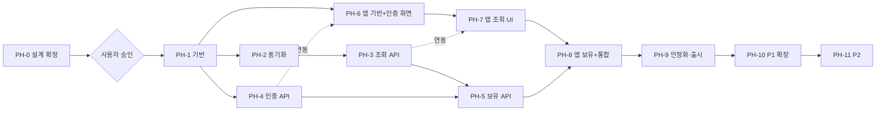

# 09. 단계별 개발 계획과 작업 목록

관련 문서: [02 기능](02-functional-spec-and-scenarios.md) · [08 테스트](08-test-plan.md) · [10 추적표](10-traceability-review.md)

> **개발 착수 조건**: 사용자가 설계 문서를 검토하고 **명시적으로 승인**한 뒤에만 PH-1 이후를 시작한다. PH-0은 설계/조사 단계이며 **소스 코드 저장소를 변경하지 않는다**.
> 일정은 정하지 않았다(사용자가 목표 일정을 미지정). 규모는 상대 크기 **S**(≈1일 이내) / **M**(2~4일) / **L**(5일 이상)로 표기하며, 개발자 수와 투입 시간이 정해지면 일정으로 환산한다.
> 기술 스택 의존 작업은 DEC 결정 후 구체화된다. 아래 작업명은 특정 기술에 종속되지 않게 작성했다.

## 0. 2차 갱신: 스택 확정(RN + Supabase)에 따른 작업 조정

아래 조정이 §2의 해당 작업에 **우선 적용**된다 (원문 표는 이력 보존을 위해 유지).

| 단계 | 조정 |
|------|------|
| PH-0 | **5차**: DEC-05/08/23 확정. 구 프로젝트 삭제는 대시보드. 잔여: 스토어 최종 앱 이름, 연령 서버 검증, **설계 승인** |
| PH-1 | T-102 "서버 스캐폴딩" → **Supabase 프로젝트 준비**(복구 또는 신규, 비용 확인 후) + Edge Function 디렉터리/공용 TS 모듈 구조. T-103 "DB 구성" → **Supabase 마이그레이션(RLS 포함)**. `users`/`refresh_tokens` 대신 `profiles` |
| PH-2 | T-203 → Edge Function `sync-catalog`(세트 단위). **T-205는 1차에서 수동 실행만**(일일 `pg_cron`은 P1). 소스는 무료 Pokémon TCG API/덤프, 앱은 DB만 조회 |
| PH-3 | T-301~T-307 → **Postgres RPC 함수**(`list_cards`, `get_card`, `list_sets`, `get_filters`) + 인덱스(pg_trgm). T-310 레이트 리밋은 §07 6.4 방식으로 |
| PH-4 | 인증 구현량 대폭 감소: T-401~T-404 → **Supabase Auth 설정 + 앱 연동**(이메일 확인, 딥링크, 속도 제한, 비밀번호 정책, CAPTCHA 검토). T-405 → **Edge Function `delete-account`**. **연령 확인(DEC-17) 서버 검증 방식 확정**. 커스텀 SMTP 연결(출시 전 필수) |
| PH-5 | T-501~T-504 → `user_cards` RLS + upsert/delete(또는 `set_owned` RPC), `list_cards`의 `owned` 결합. **RLS 테스트(TC-RLS) 포함** |
| PH-6 | SCR-02/03에 연령 확인·이메일 확인 안내 화면 추가, **FR-GATE-01(로그인 유도 후 복귀)**, 비밀번호 재설정 화면(SCR-04)을 **P1이 아니라 이 단계에서 구현**(이메일 로그인 확정 → 출시 필수) |
| PH-8 | T-804를 FR-GATE-01 전체 흐름(모든 로그인 전용 기능 공통)으로 확장. 위시리스트 MVP 포함 여부(Q2) 확정 시 이 단계에 추가 |
| PH-9 | **광고 없음(1차 확정)**. 가족 정책 광고 SDK 작업은 보류. 개인정보처리방침·연령 확인은 유지. 무료 플랜 정지 주의. 데이터 소스 종료일(2027-03-01) 대응 확인 |
| PH-10 | **세트별 진행률 제거(보류)**. FR-AUTH-06은 PH-6으로 이동, FR-AUTH-07(소셜 로그인)은 **가족 정책·로그인 SDK 제약**을 먼저 검토 |

## 1. 단계 개요와 의존성

| 단계 | 이름 | 선행 | 우선순위 | 주요 FR |
|------|------|------|----------|---------|
| PH-0 | 설계 확정·사전 조사 | - | 필수 | (전체 설계) |
| PH-1 | 프로젝트 기반 구축 | PH-0 승인 | P0 | NFR-MAINT, NFR-OBS |
| PH-2 | 카드 데이터 동기화 | PH-1 | P0 | FR-DATA-01/02 |
| PH-3 | 카드 조회 API | PH-2 | P0 | FR-SET-01, FR-CARD-01~05 |
| PH-4 | 인증/계정 API | PH-1 | P0 | FR-AUTH-01~05 |
| PH-5 | 보유·위시리스트 API | PH-3, PH-4 | P0 | FR-OWN-01~03, FR-WISH-01/02 |
| PH-6 | 앱 기반 + 인증 화면 | PH-1 (API 연동은 PH-4) | P0 | FR-AUTH-* (클라이언트) |
| PH-7 | 앱 카드 조회 UI | PH-6, PH-3 (모의 서버로 선행 가능) | P0 | FR-CARD-*, FR-SET-01 |
| PH-8 | 앱 보유·위시리스트 기능 + 통합 | PH-5, PH-7 | P0 | FR-OWN-*, FR-WISH-*, FR-GATE-01 |
| PH-9 | 안정화·보안·스토어 출시 | PH-8 | P0 | NFR 전체 |
| PH-10 | P1 기능 확장 | PH-9 (일부는 이전에도 가능) | P1 | FR-PRICE/SRCH-02/AUTH-06·07 (PROG 보류, WISH는 MVP로 이동) |
| PH-11 | P2 기능·확장 | PH-10 | P2 | FR-SCAN/LANG/I18N/WEB |

병렬 가능 구간 (인력이 2명 이상일 때)
- PH-3 ‖ PH-4 (서버 내 독립 모듈)
- PH-6 ‖ PH-2~PH-4 (앱은 OpenAPI 기반 모의 서버로 진행, 통합은 PH-8)

## 2. 단계별 상세

---

### PH-0. 설계 확정·사전 조사 (코드 변경 없음)

**목표**: 설계 문서 승인, 미확정 의사결정(DEC) 확정, 위험이 큰 가정 검증

| ID | 작업 | 규모 | 비고 |
|----|------|------|------|
| T-001 | Pokémon TCG API 실제 검증: 응답 샘플, 총 카드/세트 수, 응답 속도, 안정성, 이용 약관 확인 (HTTP 호출 조사만, 저장소 변경 없음) | S | A-01 검증, R-02/R-01 |
| T-002 | 설계 문서 사용자 검토 및 수정 반영 | M | |
| T-003 | DEC-01 클라이언트 프레임워크 확정 | S | 03 §4.1 |
| T-004 | DEC-02 백엔드, DEC-03 DB 확정 | S | 03 §4.2~4.3 |
| T-005 | DEC-04 인증 방식 확정 | S | 03 §4.4 |
| T-006 | DEC-07 게스트 열람, DEC-08 오프라인(온라인 전용 **완료**), DEC-12 iOS 범위 확정 | S | |
| T-007 | DEC-11 희귀도 정렬 순서 초안 (T-001 결과의 희귀도 목록 기반) | S | |
| T-008 | DEC-13/14 타깃 연령·수익화 계획 확인, IP 검토 일정 수립 | S | 출시 게이트 |
| T-009 | 한글판 데이터 확보 방안 조사 착수(DEC-09, 개발과 병행 가능한 조사 과제) | M | P2 입력 |
| T-010 | 작업 우선순위/일정 확정(가용 인력/시간 기준) | S | |
| T-011 | **데이터 소스(DEC-16)**: **완료(개발·1차)**. 무료 Pokémon TCG API/덤프, 앱은 DB만 조회, 유료 소스 미사용. **잔여**: 2027-03-01 전 후속 소스, 소스 약관의 DB 저장 허용 범위 원문 확인 | M | 11 §2 |
| T-012 | **IP 대응 방침(DEC-13)**: 1차 무광고·임시 앱명 `pokecard`. 잔여: 스토어 최종 이름·아이콘, 변호사 자문, 포켓몬코리아 문의 | M | 11 §1, §7 |
| T-013 | **광고·연령(DEC-14/17)**: 1차 **광고 없음 확정**. 가입 만 14세·한국 한정 확정. 잔여: 연령 서버 검증 방식, 전연령 선언 시 가족 정책(광고 외) 적용 범위 | M | 11 §3~4 |
| T-014 | **Supabase 프로젝트**: `card-dex` 생성 완료. 구 `pokemon-tcg-dex`는 삭제 방침 — **대시보드에서 사용자 삭제**(MCP에 delete 없음). 마이그레이션은 설계 승인 후 | S | 03 §8.7 |
| T-016 | ~~Q1/Q2/Q7~~ **완료**: 즐겨찾기=보유+위시, 위시 MVP, 보유 시 위시 자동 제거 없음 | S | 02 §2.5.2 |
| T-015 | 커스텀 SMTP 서비스 선정(SendGrid/AWS SES 등), 발신 도메인 준비 | S | 11 §6 |

**완료 조건**
- [ ] 사용자가 설계 문서(01~11)를 **명시적으로 승인**
- [x] DEC-16 개발·1차 방침 확정 (무료 소스, DB 적재, 유료 미사용). 잔여: 2027-03-01 전 후속 소스·약관
- [x] DEC-14 1차 무광고 확정. DEC-17 가입 연령·한국 한정 확정. 잔여: 연령 서버 검증, IP(DEC-13) 앱 이름·이미지 방침
- [x] Q1, Q2, Q7 확정
- [ ] Phase 0 필수 DEC(01, 02, 03, 04, 05(기본안), 07, 08, 11, 12)가 확정 상태로 README 갱신
- [ ] DEC-06(호스팅)은 PH-1 시작 전까지 확정 (환경 구성 T-108 선행 조건)
- [ ] T-001 결과가 문서에 반영(카드 수, 한도 대비 동기화 호출량 계산)
- [ ] 변경된 결정에 따라 03/04/05/06 문서 수정 완료

**테스트/검증 항목**
- 문서 간 정합성 재점검 (10 문서의 추적표 재검증)
- T-001: 문서화된 필드와 실제 응답 일치 여부, 호출 한도 충분성

---

### PH-1. 프로젝트 기반 구축

**목표**: 개발·테스트·배포가 가능한 뼈대와 자동화 구성

| ID | 작업 | 규모 | 관련 |
|----|------|------|------|
| T-101 | 저장소 구조 확정 및 초기화 (서버/앱/문서/공용 스펙 분리), 브랜치·커밋 규칙 | S | |
| T-102 | 서버 프로젝트 스캐폴딩: 설정/환경변수 로딩, 로깅(`requestId`), 전역 에러 핸들러(05 §1.2), `/health` | M | NFR-OBS-01 |
| T-103 | DB 구성 및 마이그레이션 체계, 초기 스키마(04: users, refresh_tokens, card_sets, cards, card_types, rarities, user_cards, sync_jobs) | M | 04 |
| T-104 | OpenAPI 문서 골격 작성(05 기반) 및 공용 타입 생성 방식 결정 | M | 계약 테스트 기준 |
| T-105 | CI 구성: 린트, 타입체크, 단위/통합 테스트(테스트 DB), 비밀 값 스캔, 의존성 감사 | M | G1 |
| T-106 | 앱 프로젝트 스캐폴딩: 내비게이션 골격, 테마/문자열 리소스 분리(NFR-I18N-01), API 클라이언트 계층, 에러/로딩 공용 컴포넌트 | M | |
| T-107 | 앱 목록 스크롤 성능 **스파이크**(이미지 다량 그리드 + 모의 데이터)로 DEC-01 타당성 검증 | S | 실패 시 DEC-01 재검토 |
| T-108 | 환경 분리(local/staging/production) 및 시크릿 관리 방식 | S | 07 §2.3 |
| T-109 | Android 프로젝트 Gradle 자동 리로드 설정(사용자 규칙 준수: `autoReloadType=ALL`), 수동 Sync 불필요 확인 | S | 03 §6 |

**완료 조건**
- [ ] 신규 환경에서 문서 절차대로 서버/앱이 로컬 실행됨
- [ ] CI가 PR마다 자동 실행되고 통과
- [ ] 마이그레이션 적용/롤백 확인
- [ ] 스파이크 결과 기록(성능 기준 충족 여부)

**테스트 항목**: 스모크(`/health`), 마이그레이션 적용·재적용, 에러 형식 단위 테스트, CI 파이프라인 자체 검증

---

### PH-2. 카드 데이터 동기화 (FR-DATA-01/02)

| ID | 작업 | 규모 | 관련 |
|----|------|------|------|
| T-201 | 외부 API 어댑터: 세트/카드 조회, 페이징, 재시도(백오프), 타임아웃, 호출 예산 제어 | M | ADR-03 |
| T-202 | 변환/검증 계층: 소스 → 내부 모델 (`hp_value`, `number_sort`, `details` JSON, `card_types`) | M | TC-DATA-07/09 |
| T-203 | 세트 단위 트랜잭션 upsert, `is_active` 처리, 증분 판단(세트 갱신 시각) | M | ADR-07 |
| T-204 | `sync_jobs` 이력, 중복 실행 방지(락) | S | |
| T-205 | **수동 전체 적재 실행 수단**(대시보드/CLI). 일일 스케줄러는 P1로 미룸 | S | DEC-16 |
| T-206 | 실패 알림(수단은 DEC-06 이후 확정) | S | FR-DATA-02 |
| T-207 | 희귀도 목록 수집 → `rarities` 초기 시드(DEC-11 확정 값) | S | |
| T-208 | 초기 전체 동기화 실행 및 실제 데이터 검증(건수, 샘플 비교) | S | A-01 |

**완료 조건**
- [ ] 빈 DB에서 전체 동기화가 성공하고 세트/카드 수가 소스와 일치
- [ ] 재실행해도 중복 없음(멱등), 부분 실패 후 재실행 시 이어서 완료
- [ ] 외부 API 중단 중에도 기존 데이터 유지
- [ ] 호출량이 일일 예산 이내

**테스트 항목**: TC-DATA-01~10, 어댑터 단위 테스트(fixture), 실제 API 스모크 1회(수동)

---

### PH-3. 카드 조회 API (FR-SET-01, FR-CARD-01~05)

| ID | 작업 | 규모 | 관련 |
|----|------|------|------|
| T-301 | `GET /sets` | S | FR-SET-01 |
| T-302 | `GET /filters` (DISTINCT + 희귀도 정렬 순서) | S | |
| T-303 | `GET /cards` 기본 목록 + 커서 페이징(정렬키+id 키셋) | L | FR-CARD-01 |
| T-304 | 이름 검색(부분 일치, 이스케이프) + 검색 인덱스 | M | FR-CARD-02 |
| T-305 | 필터(세트/타입/희귀도) 결합 규칙 | M | FR-CARD-03 |
| T-306 | 정렬 5종(허용 목록 매핑, HP 없음/희귀도 미매핑 처리) | M | FR-CARD-04 |
| T-307 | `GET /cards/{id}` 상세 | S | FR-CARD-05 |
| T-308 | 게스트/로그인 응답 분기 구조(`owned` 확장 지점 마련) | S | DEC-07 |
| T-309 | 인덱스 튜닝 및 성능 측정(2만 장 데이터) | M | NFR-PERF-01 |
| T-310 | 캐시 헤더(`/sets`, `/filters`), 레이트 리밋(게스트) | S | 07 §2.6 |

**완료 조건**
- [ ] 05 문서 3.1~3.4가 OpenAPI와 일치하고 계약 테스트 통과
- [ ] 목록 순회 시 중복·누락 0건
- [ ] 2만 장 데이터에서 p95 ≤ 300ms
- [ ] 인젝션/검증 테스트 통과

**테스트 항목**: TC-CARD-01~17, TC-SEC-01, TC-NF-01(서버 부분), 계약 테스트

---

### PH-4. 인증/계정 API (FR-AUTH-01~05) — DEC-04 확정 후 구체화

| ID | 작업 | 규모 | 관련 |
|----|------|------|------|
| T-401 | 회원가입(검증, 약관 동의 기록, 해시 저장) | M | FR-AUTH-01 |
| T-402 | 로그인 + 토큰 발급, 통합된 실패 응답 | M | FR-AUTH-02 |
| T-403 | refresh 회전/재사용 감지, 로그아웃 | M | FR-AUTH-03/04 |
| T-404 | 인증 미들웨어(`/users/me` 기준 사용자 식별), `GET /users/me` | S | |
| T-405 | 회원 탈퇴(비밀번호 재확인, CASCADE 삭제) | M | FR-AUTH-05 |
| T-406 | 로그인/가입 레이트 리밋 | S | 07 §2.6 |
| T-407 | 만료 토큰 정리 배치 | S | 04 §7 |
| T-408 | 개인정보처리방침/약관/계정 삭제 웹 안내 페이지 초안 및 호스팅 | M | 스토어 정책 |

**완료 조건**
- [ ] 05 문서 2.1~2.6 구현, 계약 테스트 통과
- [ ] 보안 테스트(비밀번호 저장, 토큰 변조, 재사용 감지, 레이트 리밋) 통과
- [ ] 탈퇴 시 관련 데이터 전부 삭제 확인

**테스트 항목**: TC-AUTH-01~14, TC-SEC-02/03/04/07

---

### PH-5. 보유 관리 API (FR-OWN-01~03)

| ID | 작업 | 규모 | 관련 |
|----|------|------|------|
| T-501 | `PUT/DELETE /users/me/cards/{cardId}` (멱등) | S | FR-OWN-01 |
| T-502 | `GET /cards` 에 `owned` 필드 결합(LEFT JOIN) | M | FR-OWN-02 |
| T-503 | `owned=owned/unowned` 필터 및 다른 조건과 조합, 비활성 보유 카드 처리 | M | FR-OWN-03 |
| T-504 | `GET /cards/{id}` 에 `owned` 결합 | S | |
| T-505 | 보유 격리/동시성 테스트, 인덱스 확인 | S | NFR-SEC-03 |
| T-506 | `wishlist_items` 테이블 + RLS + 인덱스 `(user_id, created_at desc)` (사용자 승인 후 마이그레이션) | S | FR-WISH-01, 04 §3.9 |
| T-507 | 위시 추가/제거(멱등 upsert/delete) | S | FR-WISH-01 |
| T-508 | `list_wishlist` RPC (키셋 페이징, `owned` 포함) | M | FR-WISH-02 |
| T-509 | `list_cards`/`get_card` 응답에 `wished` 결합 | M | FR-WISH-01 |
| T-510 | 위시 격리/멱등/페이징 테스트 | S | TC-WISH-01~09 |

**완료 조건**
- [ ] TC-OWN, TC-WISH(UI 제외) 전부 통과
- [ ] 사용자 간 데이터 격리 검증 통과 (보유·위시 모두 RLS)
- [ ] 성능 기준 유지(보유·위시 결합 후에도 p95 ≤ 300ms)

**테스트 항목**: TC-OWN-01~10, TC-WISH-01~09, TC-CARD-17 재측정

---

### PH-6. 앱 기반 + 인증 화면

| ID | 작업 | 규모 | 관련 |
|----|------|------|------|
| T-601 | 보안 저장소 기반 토큰 저장, 세션 관리, 자동 refresh(동시 요청 직렬화) | M | FR-AUTH-04 |
| T-602 | SCR-01 스플래시/세션 분기 | S | |
| T-603 | SCR-02 로그인, SCR-03 회원가입(검증, 오류 매핑) | M | |
| T-604 | SCR-14 내 정보, 로그아웃, SCR-15 계정 삭제, SCR-16 약관 링크 | M | FR-AUTH-03/05 |
| T-605 | 전역 오류/오프라인/재시도 UX 공용화 | S | 07 §1.4 |
| T-606 | 인증 이후 복귀 경로(로그인 유도 후 원래 화면) | S | |

**완료 조건**
- [ ] 실서버(staging) 대상 가입·로그인·로그아웃·탈퇴·자동 로그인 E2E 통과
- [ ] 토큰이 보안 저장소에만 저장됨

**테스트 항목**: TC-UI-09/10/12, TC-AUTH-08(E2E), TC-SEC-06

---

### PH-7. 앱 카드 조회 UI

| ID | 작업 | 규모 | 관련 |
|----|------|------|------|
| T-701 | SCR-10 카드 그리드 + 무한 스크롤 + 상태(로딩/빈/오류) | L | FR-CARD-01 |
| T-702 | 검색 입력(디바운스, 응답 경쟁 방지) | M | FR-CARD-02 |
| T-703 | SCR-11 필터/정렬 시트(세트 검색·그룹, 칩, 초기화, 선택 개수) | L | FR-CARD-03/04 |
| T-704 | SCR-12 카드 상세, SCR-13 이미지 확대 | M | FR-CARD-05 |
| T-705 | 이미지 캐시/지연 로딩/실패 플레이스홀더 | M | NFR-PERF-03 |
| T-706 | 게스트 모드(DEC-07 결정안) 구현 | S | |
| T-707 | 한글 검색 안내 빈 상태 | S | |

**완료 조건**
- [ ] 06 문서 SCR-10~13의 상태·동작이 구현됨
- [ ] 실서버 연동에서 검색/필터/정렬 조합이 서버 결과와 일치
- [ ] 저사양 실기기에서 스크롤 성능 기준 충족

**테스트 항목**: TC-UI-01, 05, 06, 07, 11, 14, TC-NF-02/03

---

### PH-8. 앱 보유 기능 + 통합

| ID | 작업 | 규모 | 관련 |
|----|------|------|------|
| T-801 | 보유 토글(낙관적 업데이트, 롤백, 연속 탭 병합) | M | FR-OWN-01 |
| T-802 | 목록/상세 간 보유 상태 동기화(캐시 일관성) | M | FR-OWN-02 |
| T-803 | "전체/보유/미보유" 보기 칩 + 필터 시트 연동 | M | FR-OWN-03 |
| T-804 | 게스트의 보유/위시/위시 탭 접근 → 로그인 → 복귀 후 이어서 수행 (FR-GATE-01 공통 처리) | S | |
| T-807 | 위시 토글(♡/♥, 낙관적 업데이트·롤백) — SCR-10/SCR-12, 보유 아이콘과 구분되는 UI | M | FR-WISH-01 |
| T-808 | SCR-20 위시리스트 탭(목록·빈 상태·제거 실행 취소·무한 스크롤), 목록 간 상태 동기화 | M | FR-WISH-02 |
| T-805 | 다기기 동기화 확인, 핵심 E2E 시나리오 자동화 | M | S-01~S-04 |
| T-806 | 크래시/분석 도구 도입(DEC-15) 및 개인정보 영향 반영 | S | |

**완료 조건**
- [ ] MVP 인수 기준(02 §4) 전체 충족
- [ ] TC-UI, TC-OWN E2E 통과
- [ ] 내부 테스트 트랙 배포 가능한 릴리스 빌드 생성

**테스트 항목**: TC-UI-02/03/04/08/15, TC-OWN-07/08/11

---

### PH-9. 안정화·보안·스토어 출시

| ID | 작업 | 규모 | 관련 |
|----|------|------|------|
| T-901 | 전체 회귀 + 성능/부하 + 장애 주입 테스트 | M | TC-NF |
| T-902 | 보안 점검(07 §5 체크리스트) 및 조치 | M | |
| T-903 | 기기/OS 호환성 매트릭스 테스트 | M | TC-NF-04 |
| T-904 | 접근성 점검 | S | TC-NF-05 |
| T-905 | 운영 준비: 모니터링/알림, 백업·복구 리허설, 운영 문서(장애 대응, 수동 동기화 절차) | M | |
| T-906 | 스토어 등록 자료: 아이콘/스크린샷/설명, 개인정보처리방침 URL, Data safety, 계정 삭제 링크, 콘텐츠 등급 | M | 07 §3 |
| T-907 | **IP/약관 최종 검토 및 고지 문구 반영(출시 게이트)** | M | R-01, DEC-13 |
| T-908 | 내부 테스트 → 비공개/공개 베타 → 단계적 출시 | M | G3, G4 |
| T-909 | 릴리스 후 모니터링(크래시, 동기화, 서버 지표) 1~2주 | S | |

**완료 조건**
- [ ] G4 출시 게이트 전 항목 통과 (08 §6)
- [ ] Critical/High 결함 0건
- [ ] 스토어 정책 체크리스트 완료, IP 검토 결과 반영
- [ ] 운영 문서와 롤백/복구 절차 확인

**테스트 항목**: TC-NF 전체, TC-SEC 전체, 전체 E2E 회귀

---

### PH-10. P1 기능 확장 (착수 시 각 기능 상세 설계 문서 보강)

권장 순서 **[제안]** (서로 독립이라 순서 변경 가능)

| 순서 | 기능 | 주요 작업 | 선행 | 완료 조건 / 테스트 |
|------|------|-----------|------|---------------------|
| 1 | FR-AUTH-06 비밀번호 재설정 (이메일 방식 선택 시 **출시 전 필수 → PH-9 이전으로 당길 수 있음**) | 메일 발송 인프라, 재설정 API/화면 | PH-4 | 재설정 후 세션 폐기, 링크 1회성·만료 테스트 |
| 2 | ~~FR-PROG-01 세트별 진행률~~ **보류** | 사용자 결정으로 제외. 요구가 생기면 재검토 | - | - |
| 3 | FR-PRICE-01 시세 | `card_prices` + 가격 동기화, 상세 시세 섹션, 통화/갱신일 표기 | PH-2 | 시세 없음/오래됨 처리, 동기화 장애 시 이전 값 유지 |
| 4 | ~~FR-WISH 위시리스트~~ **MVP(P0)로 이동** — PH-5(T-506~510), PH-8(T-807/808) | - | - |
| 5 | FR-SRCH-02 한글 이름 검색 | `pokemon_names` 데이터 확보/라이선스 확인, 검색 확장 | DEC-10 | 매핑 정확도, 누락 처리 |
| 6 | FR-AUTH-07 소셜 로그인 | Google 로그인 | DEC-04 | 계정 연결 정책 테스트 |

---

### PH-11. P2 기능·확장 (각각 별도 조사/설계 후 착수)

| 기능 | 선행 조사/결정 | 비고 |
|------|----------------|------|
| FR-SCAN-01 카드 스캔 | 인식 방식 PoC(OCR vs 이미지 매칭), 온디바이스/서버, 정확도 목표 | 별도 설계 문서 필요 |
| FR-LANG-01 한글판 | DEC-09 데이터 소스·라이선스, 카드 ID 체계, 영문↔한글 카드 연결 | DB 확장(04 §6) |
| FR-I18N-01 다국어 | 문자열 리소스 기반(NFR-I18N-01로 대비 완료), 번역 | 낮은 난이도 |
| FR-WEB-01 웹 | DEC-01 결과에 따른 코드 공유 전략, CORS/보안(HSTS) 추가 | 서버 변경 최소 |
| 보유 확장(수량/상태/버전) | 요구 구체화, `user_cards` 마이그레이션 | 04 §6 |
| iOS | DEC-12 | 빌드/스토어 정책 별도 |

## 3. 리스크와 완화(개발 관점)

| 리스크 | 시점 | 완화 |
|--------|------|------|
| 외부 API가 실제로 느리거나 불안정 | PH-0 T-001, PH-2 | 조기 검증, 백오프/재개 가능 동기화 |
| 이미지 그리드 성능 | PH-1 T-107 | 스파이크, 이미지 캐시/썸네일 사용 |
| 이름 부분 일치 검색 성능 | PH-3 | 엔진별 검색 인덱스, 성능 테스트 |
| 한국어 UI + 영문 카드명의 검색 불편 | PH-7 이후 | FR-SRCH-02 우선 검토 |
| IP/약관 문제로 출시 지연 | PH-9 | PH-0에서 일정 수립, 병행 검토 |
| 인증 직접 구현 부담/보안 | PH-4 | 검증된 라이브러리, 보안 테스트, 또는 BaaS 검토(DEC-04) |
| 1인 개발 시 일정 지연 | 전체 | 범위 고정(P0), P1은 출시 후 |

## 4. 변경 관리
- 설계 변경은 해당 문서와 10 추적표를 함께 갱신 (코드보다 문서 먼저)
- 각 PR은 관련 FR/TC ID를 명시
- 단계 종료 시 완료 조건 체크 후 사용자에게 데모/보고하고 다음 단계 진행

## 5. 승인 게이트 요약
1. PH-0 완료 → **사용자 승인** → PH-1 시작 (**이 승인 전까지 코드 작성 없음**)
2. 각 단계 완료 조건 충족 → 다음 단계
3. PH-9 G4 출시 게이트 + 사용자 최종 승인 → 스토어 출시
